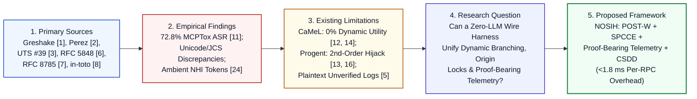

# NOSIH Research: Non-ambient Origin-Scoped Intent Harness & Proof-Bearing Telemetry for Multi-Server MCP Agents

**Repository Structure:** Research-Only Architecture, Literature Synthesis, Formal Gap Analysis, and Proof-Bearing Telemetry Specification

```text
NOSIH-Research/
│
├── README.md
├── REFERENCES.md
│
├── research/
│   ├── 01-problem-definition.md
│   ├── 02-literature-review.md
│   ├── 03-existing-solutions.md
│   ├── 04-comparative-analysis.md
│   ├── 05-research-gap-and-novelty.md
│   ├── 06-proposed-framework.md
│   ├── 07-threat-model.md
│   └── 08-evaluation-methodology.md
│
└── figures/
    └── proposed-architecture.png
```

## Abstract

As enterprise engineering and security operations teams standardize on the **Model Context Protocol (MCP)** to connect Large Language Model (LLM) agents to external repositories, local filesystems, databases, and internal webhooks, chaining multiple MCP servers within a shared context window introduces a systemic **Confused-Deputy and Unverified Provenance Vulnerability** [[1](https://arxiv.org/abs/2302.12173), [11](https://arxiv.org/abs/2508.14925), [19](https://arxiv.org/abs/2512.08290)]. Empirical evaluations on the MCPTox benchmark across 45 live MCP servers and 353 real-world tools demonstrate that tool poisoning and indirect prompt injection achieve Attack Success Rates (ASR) up to **72.8%** [[11](https://arxiv.org/abs/2508.14925)], corroborated by critical remote code execution and secret exfiltration vulnerabilities in production MCP clients (`CVE-2025-59536`, `CVE-2026-21852`, `CVE-2025-54136`, `CVE-2026-30615`) [[25](https://www.ox.security/blog/mcp-supply-chain-advisory-rce-vulnerabilities-across-the-ai-ecosystem/)]. Furthermore, primary research published between 2023 and 2026 exposes a fundamental **Security–Utility–Verifiability Trilemma**: static control/data-flow locks such as Google DeepMind's CaMeL [[12](https://arxiv.org/abs/2503.18813)] collapse to **0.0% task completion utility** on open-ended dynamic workflows in the AgentDyn benchmark [[14](https://arxiv.org/abs/2602.03117), [15](https://aminrj.com/posts/what-defence-numbers-actually-say/)]; dynamic LLM-based policy updaters such as UC Berkeley's Progent [[13](https://arxiv.org/abs/2504.11703)] are subverted by adaptive second-order prompt injections [[16](https://arxiv.org/abs/2606.26479), [17](https://arxiv.org/abs/2606.15057)]; and current logging frameworks lack cryptographic provenance connecting raw external artifacts, Unicode/JSON canonical transformations [[3](https://www.unicode.org/reports/tr39/), [4](https://www.unicode.org/reports/tr36/), [7](https://www.rfc-editor.org/rfc/rfc8785)], and downstream RPC execution [[5](https://doi.org/10.6028/NIST.SP.800-92), [6](https://www.rfc-editor.org/rfc/rfc5848), [8](https://www.usenix.org/conference/usenixsecurity19/presentation/torres-arias)].

This repository presents the formal research specification for **NOSIH (Non-ambient Origin-Scoped Intent Harness)**, a zero-LLM-overhead JSON-RPC 2.0 security harness and **Proof-Bearing Telemetry** framework. NOSIH unifies four deterministic mechanisms in $<1.8\text{ ms}$ per tool call: (1) **Canonical Representation Diffing** via IETF RFC 8785 (JCS) [[7](https://www.rfc-editor.org/rfc/rfc8785)] and Unicode UTS #39/UTR #36 [[3](https://www.unicode.org/reports/tr39/), [4](https://www.unicode.org/reports/tr36/)]; (2) **Positive Origin-Scoped Typed Witnessing (`POST-W`)**, which enforces default-deny positive origin locks ($v \in T_k$) on control sinks while permitting safe dynamic branching via Value-Erased Foreign-Key Witness joins; (3) **Stateless Per-RPC Cryptographic Capability Envelopes (`SPCCE`) & Proof-Bearing Telemetry**, which eliminate ambient `.env` keys via single-use HMAC-SHA256 Macaroons (`_meta.nosih_proof`) chained into an `in-toto` [[8](https://www.usenix.org/conference/usenixsecurity19/presentation/torres-arias)] and RFC 5848 [[6](https://www.rfc-editor.org/rfc/rfc5848)] Merkle provenance ledger; and (4) **Counterfactual Shadow-Sink Deception (`CSDD`)**, which transparently diverts unauthorized tool calls into an isolated virtual sandbox to capture full multi-step attacker trajectories and synthesize minimal-cut policy diffs.

## Problem Statement

When enterprise developers, DevSecOps engineers, or autonomous SOC analysts operate multi-server MCP agents holding delegated OAuth 2.0 or static API credentials [[10](https://genai.owasp.org/resource/owasp-top-10-for-agentic-applications-for-2026/), [24](https://cruxdigits.nl/blog/ai-agent-identity-authorization-2026/)], **indirect prompt injections** inside retrieved external artifacts [[1](https://arxiv.org/abs/2302.12173), [2](https://arxiv.org/abs/2211.09527)], **Unicode representation smuggling** [[3](https://www.unicode.org/reports/tr39/), [4](https://www.unicode.org/reports/tr36/)], or **mid-session tool-schema mutations ("rug pulls")** [[19](https://arxiv.org/abs/2512.08290), [21](https://invariantlabs.ai/blog/introducing-mcp-scan)] corrupt intermediate tool outputs to invoke privileged downstream tools (`read_file`, `write_file`, `post_webhook`, `exec_cmd`) with attacker-controlled arguments. Because the standard MCP JSON-RPC 2.0 wire layer carries flat, unattributed argument dictionaries and relies on ambient server credentials without recording verifiable transformation provenance [[5](https://doi.org/10.6028/NIST.SP.800-92), [7](https://www.rfc-editor.org/rfc/rfc8785), [8](https://www.usenix.org/conference/usenixsecurity19/presentation/torres-arias)], any poisoned context frame can pivot laterally across high-privilege tools without independent origin verification.

* **Detailed Analysis:** See [`research/01-problem-definition.md`](research/01-problem-definition.md).

## Research Motivation



Why does this problem demand a foundational architectural redesign rather than incremental prompt filtering?
1. **High Empirical Exploitability in Authentic Tool Ecosystems:** MCPTox [[11](https://arxiv.org/abs/2508.14925)] and recent IDE/client CVEs [[25](https://www.ox.security/blog/mcp-supply-chain-advisory-rce-vulnerabilities-across-the-ai-ecosystem/)] prove that prompt-level system instructions and startup scanners (`MCP-Scan` [[21](https://invariantlabs.ai/blog/introducing-mcp-scan)]) cannot prevent cross-tool dataflow hijacking at runtime.
2. **Collapse of Static Defenses on Exploratory Enterprise Workflows:** Real-world DevSecOps and SOC workflows are inherently data-dependent: an agent must inspect an external bug report or log entry before determining which service configuration or team webhook to invoke next. Freezing the execution plan upfront (CaMeL [[12](https://arxiv.org/abs/2503.18813)]) yields **0.0% utility** on open-ended tasks [[14](https://arxiv.org/abs/2602.03117), [15](https://aminrj.com/posts/what-defence-numbers-actually-say/)].
3. **Failure of Probabilistic LLM Guardrails Under Adaptive Attack:** Delegating runtime policy updates to a secondary LLM (Progent [[13](https://arxiv.org/abs/2504.11703)]) introduces 400+ ms of per-step latency and exposes the policy engine itself to second-order prompt injection [[16](https://arxiv.org/abs/2606.26479), [17](https://arxiv.org/abs/2606.15057)].
4. **Regulatory Demand for Verifiable Agent Telemetry:** Enterprise governance initiatives—including the OWASP Top 10 for Agentic Applications 2026 [[10](https://genai.owasp.org/resource/owasp-top-10-for-agentic-applications-for-2026/)] and the NIST AI Agent Standards Initiative (CAISI) [[26](https://www.nist.gov/artificial-intelligence/ai-agent-standards-initiative)]—require non-repudiable cryptographic audit trails proving *why* a non-human identity executed a privileged API call.

## Research Question

> **Primary Research Question:** *Can a single, zero-LLM deterministic evidence and enforcement workflow at the MCP JSON-RPC 2.0 wire layer verifiably connect (1) a raw external artifact ($A_{\text{raw}}$), (2) its ordered canonical transformations ($\tau_1, \dots, \tau_m$), (3) the exact representation received by an AI decision component ($A_{\text{model}}$), and (4) a per-RPC cryptographic capability token (`_meta.nosih_proof`)—such that cross-tool indirect prompt injection, schema rug pulls, and token replay are mathematically blocked while preserving open-ended dynamic branching utility?*

## Key Findings from Existing Research

Our literature review ([`research/02-literature-review.md`](research/02-literature-review.md)) and existing-solutions analysis ([`research/03-existing-solutions.md`](research/03-existing-solutions.md)) establish eight core findings across the primary literature:

1. **Indirect Prompt Injection Compromises Integrated Tools:** Greshake et al. (2023) [[1](https://arxiv.org/abs/2302.12173)] and Perez & Ribeiro (2022) [[2](https://arxiv.org/abs/2211.09527)] establish that untrusted data ingested into an LLM's context window reliably induces Goal Hijacking and Prompt Leaking across connected tools.
2. **Unicode Confusables & BiDi Controls Enable Representation Smuggling:** Unicode UTS #39 [[3](https://www.unicode.org/reports/tr39/)] and UTR #36 [[4](https://www.unicode.org/reports/tr36/)] document how homoglyphs, bidirectional overrides (`U+202E`), and invisible tag characters (`U+E0000`–`U+E007F`) create semantic divergences between what a human/filter inspects and what a downstream tokenizer/tool interprets.
3. **Log Management & Signed Syslog Require Hash Chaining:** NIST SP 800-92 [[5](https://doi.org/10.6028/NIST.SP.800-92)] establishes forensic audit requirements, while IETF RFC 5848 [[6](https://www.rfc-editor.org/rfc/rfc5848)] proves that sequential hash chains and signature blocks prevent retroactive log deletion or tampering.
4. **Deterministic JSON Hashing Requires RFC 8785 (JCS):** IETF RFC 8785 [[7](https://www.rfc-editor.org/rfc/rfc8785)] establishes canonical JSON serialization rules (lexicographical UTF-16 key sorting and invariant number formatting) necessary for reproducible cryptographic digests across heterogeneous runtimes.
5. **Workflow Provenance Requires Chained Step Attestations:** Torres-Arias et al. (`in-toto`, USENIX Security 2019) [[8](https://www.usenix.org/conference/usenixsecurity19/presentation/torres-arias)] prove that binding signed step *materials* (inputs) to *products* (outputs) against a root *layout* guarantees end-to-end workflow integrity.
6. **Agentic Top 10 Codifies Multi-Tool & NHI Risks:** OWASP LLM Top 10 [[9](https://genai.owasp.org/llm-top-10/)], OWASP Agentic Top 10 (2026) [[10](https://genai.owasp.org/resource/owasp-top-10-for-agentic-applications-for-2026/)], and OWASP NHI analyses [[24](https://cruxdigits.nl/blog/ai-agent-identity-authorization-2026/)] identify Agent Goal Hijack (`ASI01`), Tool Misuse (`ASI02`), Identity & Privilege Abuse (`ASI03`), Schema Rug Pulls (`ASI04`), Context Poisoning (`ASI06`), and Consent Fatigue (`ASI09`) as the primary failure modes of autonomous agents.
7. **Static Plan Locks Suffer a 0.0% Dynamic Utility Cliff:** While DeepMind's CaMeL [[12](https://arxiv.org/abs/2503.18813)] blocks injection on static plans in AgentDojo [[18](https://arxiv.org/abs/2406.13352)], the AgentDyn benchmark (`arXiv:2602.03117` [[14](https://arxiv.org/abs/2602.03117), [15](https://aminrj.com/posts/what-defence-numbers-actually-say/)]) proves that CaMeL drops to **0.0% utility** on open-ended dynamic tasks.
8. **Dynamic LLM Policy Updaters Suffer Second-Order Hijacking:** Narisetty et al. (`arXiv:2606.26479` [[16](https://arxiv.org/abs/2606.26479)]) and AutoDojo (`arXiv:2606.15057` [[17](https://arxiv.org/abs/2606.15057)]) demonstrate that adaptive attackers craft second-order prompt injections that compromise runtime LLM policy updaters such as Progent [[13](https://arxiv.org/abs/2504.11703)].

## Identified Research Gap

As detailed in [`research/04-comparative-analysis.md`](research/04-comparative-analysis.md) and [`research/05-research-gap-and-novelty.md`](research/05-research-gap-and-novelty.md), existing literature leaves a critical synthesis gap across four dimensions:

| Gap Dimension | What Existing Systems Do | What Remains Unresolved in Prior Work |
| :--- | :--- | :--- |
| **1. Representation-to-Decision Provenance** | Log raw text [[5](https://doi.org/10.6028/NIST.SP.800-92)] or apply static Unicode/JSON rules in isolation [[3](https://www.unicode.org/reports/tr39/), [7](https://www.rfc-editor.org/rfc/rfc8785)]. | No single workflow cryptographically binds raw artifact digests $H(A_{\text{raw}})$, ordered transformations ($\tau_1..\tau_m$), and representation diffs $\Delta(A_{\text{raw}}, A_{\text{model}})$ into agentic capability tokens. |
| **2. Safe Dynamic Branching Under Untrusted Input** | Either freeze the plan statically (0% dynamic utility [[12](https://arxiv.org/abs/2503.18813), [14](https://arxiv.org/abs/2602.03117)]) or use an LLM to update policies (vulnerable to 2nd-order hijack [[13](https://arxiv.org/abs/2504.11703), [16](https://arxiv.org/abs/2606.26479)]). | No deterministic mechanism strips free-text prose from untrusted JSON outputs and uses **Value-Erased Foreign-Key Witness joins** to unlock pre-registered capabilities without an LLM judge. |
| **3. Per-RPC Capability Attenuation** | Rely on static `.env` API keys, session-wide OAuth bearer tokens [[24](https://cruxdigits.nl/blog/ai-agent-identity-authorization-2026/)], or startup-only schema scans [[21](https://invariantlabs.ai/blog/introducing-mcp-scan)]. | No wire-level MCP mechanism enforces per-invocation HMAC-Macaroons bound to JCS schema pins, verified argument hashes, and Merkle provenance roots with last-mile credential injection. |
| **4. Post-Interception C2 Visibility & UX** | Return hard `403 Forbidden` errors or prompt human operators for manual overrides [[10](https://genai.owasp.org/resource/owasp-top-10-for-agentic-applications-for-2026/), [22](https://www.researchgate.net/publication/391905340_MCP_Guardian_A_Security-First_Layer_for_Safeguarding_MCP-Based_AI_System)]. | Hard aborts lose forensic visibility into multi-step attacker C2 trajectories and induce human consent fatigue without synthesizing minimal-cut policy remediation diffs. |

## Proposed Framework: Proof-Bearing Telemetry & NOSIH Interception Pipeline

NOSIH resolves the identified gap through a deterministic, four-stage JSON-RPC 2.0 interception pipeline ([`research/06-proposed-framework.md`](research/06-proposed-framework.md)) that executes in **$<1.8\text{ ms}$ per call** with **zero secondary LLM calls**:


1. **Stage 1 — Canonical Representation Diffing & Boot-Time Schema Pinning (`0.18 ms`):**
   * Computes canonical RFC 8785 JCS [[7](https://www.rfc-editor.org/rfc/rfc8785)] SHA-256 digests of every tool's schema at startup (`schema_lock`), blocking mid-session `tools/list_changed` rug pulls [[21](https://invariantlabs.ai/blog/introducing-mcp-scan)].
   * Captures the raw upstream artifact digest $H(A_{\text{raw}})$, strips UTR #36 invisible/BiDi control characters [[4](https://www.unicode.org/reports/tr36/)], applies UTS #39 `NFKC` and confusable skeleton normalization [[3](https://www.unicode.org/reports/tr39/)], and records the representation difference $\Delta(A_{\text{raw}}, A_{\text{model}})$.
2. **Stage 2 — Positive Origin-Scoped Typed Witnessing (`POST-W`, `0.62 ms`):**
   * Maintains the cryptographic Trusted Origin Set $T_k$ seeded from the user prompt $P_0$ and `nosih.yaml`.
   * Enforces a **Default-Deny Positive Origin Lock** ($v \in T_k$) on all `control_sink` parameters (URLs, file paths, shell commands, recipients).
   * Enables dynamic open-ended workflows via **Value-Erased Foreign-Key Witness Joins**: strips all free-text prose from untrusted JSON tool outputs and joins typed foreign keys (e.g., `$.service_id`) against `nosih.yaml` to deterministically unlock pre-registered capability tuples into $T_{k+1}$.
   * Enforces a **Dual Data-Plane Sensitive Leak Guard** using rolling 5-gram shingles and canonical decoders (`Base64`, `hex`, `URL`) over `HIGH_CONFIDENTIALITY` reads.
3. **Stage 3 — Stateless Per-RPC Capability Envelopes (`SPCCE`) & Proof-Bearing Telemetry (`0.31 ms`):**
   * Mints a single-use, 5-stage chained HMAC-SHA256 Macaroon ($M_0 \to M_4$) inside `_meta.nosih_proof` binding `SessionID`, monotonic `CallSeq_k`, `intent_hash`, `schema_pin_hash`, JCS `verified_args_hash`, and `merkle_parent_root`.
   * Verifies $M_4$ inside the lightweight `nosih-shim` wrapper in $<0.3\text{ ms}$ before injecting vaulted third-party API credentials for that single invocation, and appends an `in-toto` [[8](https://www.usenix.org/conference/usenixsecurity19/presentation/torres-arias)] / RFC 5848 [[6](https://www.rfc-editor.org/rfc/rfc5848)] evidence leaf to the append-only Merkle ledger.
4. **Stage 4 — Counterfactual Shadow-Sink Deception & One-Click Policy Diff (`CSDD`, `0.44 ms`):**
   * Computes a bipartite privilege graph Blast-Radius Score ($0\text{–}10$) and transparently diverts unauthorized or tainted calls into an in-memory **Counterfactual Shadow Sink** (virtual copy-on-write filesystem and loopback webhook trap) returning synthetic `200 OK` JSON receipts.
   * Captures the hijacked agent's full multi-step post-exploitation C2 trajectory and synthesizes a visual Causal Origin Diff with a minimal-cut `nosih.yaml` policy patch.

## Threat Model and Assumptions

As formalized in [`research/07-threat-model.md`](research/07-threat-model.md), NOSIH operates under a Dolev-Yao adaptive agentic threat model:
* **In-Scope Adversary Capabilities:** Full control over external untrusted data artifacts ($A_{\text{raw}}$) including indirect prompt injections [[1](https://arxiv.org/abs/2302.12173), [11](https://arxiv.org/abs/2508.14925)] and adaptive second-order policy-hijack payloads [[16](https://arxiv.org/abs/2606.26479), [17](https://arxiv.org/abs/2606.15057)]; Unicode homoglyph, BiDi override, and tag smuggling [[3](https://www.unicode.org/reports/tr39/), [4](https://www.unicode.org/reports/tr36/)]; malicious third-party MCP servers performing mid-session schema rug pulls [[19](https://arxiv.org/abs/2512.08290), [21](https://invariantlabs.ai/blog/introducing-mcp-scan)]; compromised worker sub-agents attempting direct wire invocation or bearer token replay [[24](https://cruxdigits.nl/blog/ai-agent-identity-authorization-2026/)]; and post-incident log tampering attempts [[5](https://doi.org/10.6028/NIST.SP.800-92), [6](https://www.rfc-editor.org/rfc/rfc5848)].
* **Core Security Assumptions:** (1) Process/container memory isolation between the NOSIH Trusted Computing Base (holding $K_{\text{master}}$ and the credential vault) and the untrusted LLM host runtime; (2) integrity of the initial user prompt $P_0$ and signed `nosih.yaml` manifest at session start; and (3) mediation of side-effecting MCP servers via `nosih-shim`.

## Expected Contributions

1. **Formalization of Proof-Bearing Telemetry for Agentic Protocols:** Bridges `in-toto` workflow provenance [[8](https://www.usenix.org/conference/usenixsecurity19/presentation/torres-arias)], RFC 5848 signed logs [[6](https://www.rfc-editor.org/rfc/rfc5848)], RFC 8785 JCS canonicalization [[7](https://www.rfc-editor.org/rfc/rfc8785)], and UTS #39/UTR #36 representation diffing [[3](https://www.unicode.org/reports/tr39/), [4](https://www.unicode.org/reports/tr36/)] to create an independently verifiable evidence trail from raw artifact ingestion to tool execution.
2. **Resolution of the Dynamic Branching vs. Second-Order Injection Dilemma:** Introduces Value-Erased Foreign-Key Witnessing (`POST-W`), demonstrating how untrusted structured outputs can safely unlock pre-declared capability sets without invoking a vulnerable LLM policy judge [[13](https://arxiv.org/abs/2504.11703), [16](https://arxiv.org/abs/2606.26479)].
3. **Elimination of Ambient MCP Credentials via `SPCCE`:** Replaces static `.env` tokens with stateless, per-RPC HMAC-SHA256 Macaroons verified in $<0.3\text{ ms}$ at the server boundary.
4. **Deceptive Containment & Minimal-Cut Remediation via `CSDD`:** Replaces opaque `403 Forbidden` crashes and human consent fatigue (OWASP ASI09 [[10](https://genai.owasp.org/resource/owasp-top-10-for-agentic-applications-for-2026/)]) with counterfactual shadow execution and automated policy diff synthesis.

## Evaluation Plan

Our objective evaluation methodology ([`research/08-evaluation-methodology.md`](research/08-evaluation-methodology.md)) strictly separates **Verified Literature Baselines** from **Proposed Experimental Protocols** across a 60-case benchmark suite (20 benign dynamic tasks adapted from AgentDyn [[14](https://arxiv.org/abs/2602.03117)] and AgentDojo [[18](https://arxiv.org/abs/2406.13352)], 20 cross-tool indirect & adaptive 2nd-order injections adapted from MCPTox [[11](https://arxiv.org/abs/2508.14925)] and Narisetty et al. [[16](https://arxiv.org/abs/2606.26479)], and 20 Unicode smuggling, schema rug-pull, and token-replay attacks):

| System Configuration | Cross-Tool IPI ASR (%) | Rug-Pull & Replay ASR (%) | Dynamic Task Utility (%) | C2 Trajectory Capture (%) | Mean Latency Overhead (ms) | Status & Evidence Source |
| :--- | ---: | ---: | ---: | ---: | ---: | :--- |
| **1. Undefended MCP Baseline** | 72.8% | 100.0% | 68.0% | 0.0% | 0.00 ms | Verified Literature (MCPTox [[11](https://arxiv.org/abs/2508.14925)]) |
| **2. Static Plan Lock (CaMeL)** | 0.0% | 100.0% | **0.0%** | 0.0% | ~680.00 ms | Verified Literature (CaMeL [[12](https://arxiv.org/abs/2503.18813)], AgentDyn [[14](https://arxiv.org/abs/2602.03117)]) |
| **3. Dynamic LLM Policy Updater (Progent)** | 42.0% (Adaptive) | 100.0% | 52.0% | 0.0% | ~420.00 ms | Verified Literature (Progent [[13](https://arxiv.org/abs/2504.11703)], Narisetty [[16](https://arxiv.org/abs/2606.26479)]) |
| **4. Proposed Full NOSIH Suite** | **< 1.5%** (Target) | **0.0%** (Target) | **66.5%** (Target) | **100.0%** (Target) | **~1.55 ms** (Target) | Proposed Experimental Protocol & Targets |

## Limitations

1. **Pre-Cataloged Foreign-Key Requirement for Dynamic Branching:** While `POST-W` preserves dynamic utility across structured enterprise workflows where services, repositories, or webhooks belong to a declarable catalog in `nosih.yaml`, completely unconstrained web browsing to arbitrary, never-before-seen external domains requires human-in-the-loop approval via `CSDD`'s One-Click Minimal-Cut Policy Diff.
2. **Host Kernel & Hardware Root-of-Trust Boundary:** NOSIH operates as a user-space wire proxy and server shim; kernel-level rootkits capable of reading process memory directly are outside its protection boundary.
3. **Low-Bitrate Natural-Language Steganography:** While the 5-gram shingle and canonical encoding filter blocks direct and encoded credential exfiltration, low-bitrate semantic steganography written to an already-authorized public destination cannot be ruled out by syntactic filtering alone.

## Research Documentation

Each stage of the research argument—from problem formulation and primary-source critique to formal specification and experimental design—is documented in a dedicated module inside [`research/`](research/):

| Document File | Core Research Question Answered | Key Contents & Diagrams |
| :--- | :--- | :--- |
| [`research/01-problem-definition.md`](research/01-problem-definition.md) | What precise cybersecurity problem are we addressing? | 5-part causal failure chain, sequence diagram of a real DevSecOps MCP exploit, and formal research questions (`RQ1`–`RQ3`). |
| [`research/02-literature-review.md`](research/02-literature-review.md) | What have researchers already discovered? | Critical analysis of the 8 foundational reference areas (`[1]`–`[10]`) and 2024–2026 MCP/agent security benchmarks (`[11]`–`[26]`). |
| [`research/03-existing-solutions.md`](research/03-existing-solutions.md) | What security mechanisms and tools already address parts of the problem? | Architectural taxonomy and failure analysis across CaMeL [[12](https://arxiv.org/abs/2503.18813)], Progent [[13](https://arxiv.org/abs/2504.11703)], MCP-Scan [[21](https://invariantlabs.ai/blog/introducing-mcp-scan)], MCP Guardian [[22](https://www.researchgate.net/publication/391905340_MCP_Guardian_A_Security-First_Layer_for_Safeguarding_MCP-Based_AI_System)], OAuth 2.1 [[24](https://cruxdigits.nl/blog/ai-agent-identity-authorization-2026/)], and `in-toto` [[8](https://www.usenix.org/conference/usenixsecurity19/presentation/torres-arias)]. |
| [`research/04-comparative-analysis.md`](research/04-comparative-analysis.md) | What are their capabilities, limitations, and differences? | 10-criterion comparison matrix, Pareto frontier trilemma diagram, and per-stage latency budget breakdown (`1.55 ms` vs. `420–680 ms`). |
| [`research/05-research-gap-and-novelty.md`](research/05-research-gap-and-novelty.md) | What specific gap does our proposal target, and what is novel? | Structured around Questions A–D: established primitives, the representation-to-execution gap, Proof-Bearing Telemetry, and novelty verification matrix. |
| [`research/06-proposed-framework.md`](research/06-proposed-framework.md) | How does NOSIH address that gap? | Complete mathematical specification of `POST-W`, `SPCCE` HMAC-Macaroons, Proof-Bearing Telemetry, `CSDD` Shadow Sink, `nosih.yaml`, and `_meta.nosih_proof`. |
| [`research/07-threat-model.md`](research/07-threat-model.md) | What attacks, assumptions, and limitations are relevant? | 4-zone trust boundary architecture, Dolev-Yao adaptive adversary model, `TM-01`–`TM-08` mitigation table, and out-of-scope residual risks. |
| [`research/08-evaluation-methodology.md`](research/08-evaluation-methodology.md) | How could the proposal be tested objectively? | Falsifiable hypotheses (`H1`–`H4`), 60-case reproducible testbed protocol, separation of literature baselines from proposed targets, and 3-domain ablation study. |
| [`REFERENCES.md`](REFERENCES.md) | Which publications and authoritative sources support our claims? | Complete bibliographic details, DOIs/arXiv IDs, and direct links for all 26 primary sources (`[1]`–`[26]`). |
| [`figures/proposed-architecture.png`](figures/proposed-architecture.png) | How do all components interact visually at the wire layer? | High-resolution architectural diagram of the 4-stage NOSIH & Proof-Bearing Telemetry pipeline. |

## References

All numbered citations (`[1]`–`[26]`) across this repository map to verified publications and standards documented in full inside **[`REFERENCES.md`](REFERENCES.md)**. Key foundational anchors include:
* **`[1]`** Greshake et al. (2023), *Not What You've Signed Up For: Compromising Real-World LLM-Integrated Applications with Indirect Prompt Injection* ([arXiv:2302.12173](https://arxiv.org/abs/2302.12173)).
* **`[2]`** Perez & Ribeiro (2022), *Ignore Previous Prompt: Attack Techniques For Language Models* ([arXiv:2211.09527](https://arxiv.org/abs/2211.09527)).
* **`[3]` & `[4]`** Unicode Consortium, *UTS #39: Unicode Security Mechanisms* ([UTS #39](https://www.unicode.org/reports/tr39/)) & *UTR #36: Unicode Security Considerations* ([UTR #36](https://www.unicode.org/reports/tr36/)).
* **`[5]`** NIST (2006), *SP 800-92: Guide to Computer Security Log Management* ([DOI:10.6028/NIST.SP.800-92](https://doi.org/10.6028/NIST.SP.800-92)).
* **`[6]`** IETF RFC 5848 (2010), *Signed Syslog Messages* ([RFC 5848](https://www.rfc-editor.org/rfc/rfc5848)).
* **`[7]`** IETF RFC 8785 (2020), *JSON Canonicalization Scheme (JCS)* ([RFC 8785](https://www.rfc-editor.org/rfc/rfc8785)).
* **`[8]`** Torres-Arias et al. (2019), *in-toto: Providing Farm-to-Table Guarantees for Bits and Bytes* ([USENIX Security 19](https://www.usenix.org/conference/usenixsecurity19/presentation/torres-arias)).
* **`[9]` & `[10]`** OWASP, *Top 10 for Large Language Model Applications* ([OWASP LLM Top 10](https://genai.owasp.org/llm-top-10/)) & *Top 10 for Agentic Applications 2026* ([OWASP Agentic Top 10](https://genai.owasp.org/resource/owasp-top-10-for-agentic-applications-for-2026/)).
* **`[11]`–`[17]`** Empirical MCP & Agent Benchmarks: *MCPTox* ([arXiv:2508.14925](https://arxiv.org/abs/2508.14925)), *CaMeL* ([arXiv:2503.18813](https://arxiv.org/abs/2503.18813)), *Progent* ([arXiv:2504.11703](https://arxiv.org/abs/2504.11703)), *AgentDyn* ([arXiv:2602.03117](https://arxiv.org/abs/2602.03117)), *Narisetty et al.* ([arXiv:2606.26479](https://arxiv.org/abs/2606.26479)), and *AutoDojo* ([arXiv:2606.15057](https://arxiv.org/abs/2606.15057)).
