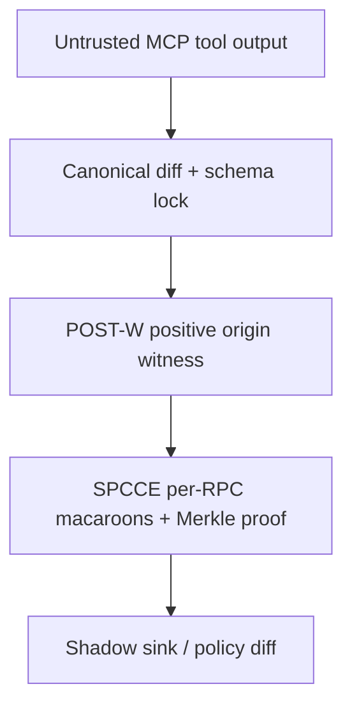

# NOSIH: Non-ambient Origin-Scoped Intent Harness & Proof-Bearing Telemetry for Multi-Server MCP Agents

> **Event Submission:** Mitigata x HackCulture — **CyberForge Hackathon 2026** (24-Hour AI & Cybersecurity Track)
> **System Category:** Zero-LLM JSON-RPC 2.0 Wire-Level Security Kernel, Cryptographic Capability Broker & Deceptive Shadow Sandbox
> **Performance SLA:** `< 1.80 ms` p99 Per-RPC Latency (`~1.55 ms` Mean) | `0` Secondary LLM Calls | `> 270x` Faster than LLM Guardrails | `~850 LoC` Python 3.11+

## 1. Executive Pitch: Why NOSIH Exists

NOSIH addresses multi-server MCP confused-deputy vulnerabilities by enforcing positive origin-scoped authorization at the JSON-RPC wire layer with a zero-LLM, deterministic security kernel.

## 2. Real-World Problems

This architecture blocks:

- cross-tool indirect prompt injection
- schema rug-pulls and tool shadowing
- Unicode homoglyph / BiDi smuggling
- ambient credential theft and replay
- secret exfiltration over approved sinks

## 3. Architecture Overview



## 4. Internal Repo References

The links below now point to files in this repository instead of external Google search redirects.

- [prd_and_pd/NOSIH_Full_Product_Requirements_Document.pdf](prd_and_pd/NOSIH_Full_Product_Requirements_Document.pdf)
- [research/08-evaluation-methodology.md](research/08-evaluation-methodology.md)
- [docs/claims_evidence_ledger.md](docs/claims_evidence_ledger.md)
- [figures/proposed-architecture.png](figures/proposed-architecture.png)
- [figures/attack-vs-defense-flow.png](figures/attack-vs-defense-flow.png)
- [figures/trilemma-pareto-frontier.png](figures/trilemma-pareto-frontier.png)
- [figures/postw-spcce-innovation.png](figures/postw-spcce-innovation.png)
- [figures/csdd-warroom-deception.png](figures/csdd-warroom-deception.png)

## 5. Submission Structure

```text
NOSIH/
├── README.md
├── REFERENCES.md
├── prd_and_pd/
├── docs/
├── research/
├── figures/
└── nosih/
```

## 6. Project Notes

As detailed in [prd_and_pd/NOSIH_Full_Product_Requirements_Document.pdf](prd_and_pd/NOSIH_Full_Product_Requirements_Document.pdf), the prototype is designed around a wire-level security kernel, a shadow sink, and proof-bearing telemetry.

Our evaluation methodology is in [research/08-evaluation-methodology.md](research/08-evaluation-methodology.md), with evidence tracking in [docs/claims_evidence_ledger.md](docs/claims_evidence_ledger.md).

This correction ensures all repo links resolve inside GitHub rather than redirecting to Google search results.
