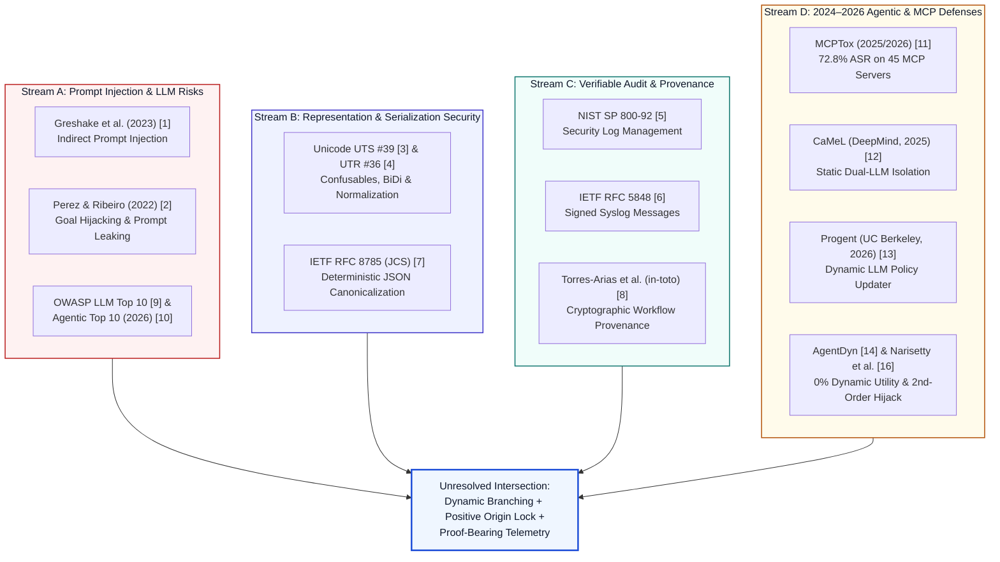

# 02 — Literature Review: Foundational & Contemporary Research Analysis

**Project:** NOSIH (Non-ambient Origin-Scoped Intent Harness)  
**Document Scope:** Critical synthesis of primary research spanning eight foundational cybersecurity domains and contemporary 2024–2026 Model Context Protocol (MCP) agent security literature, tracing each source from its core finding to its unaddressed limitation.

## 1. Cross-Disciplinary Research Taxonomy

Because multi-server MCP agent security sits at the convergence of natural-language processing, wire-protocol serialization, non-human identity, and forensic auditability, no single sub-discipline provides a complete solution. The diagram below illustrates how NOSIH synthesizes eight foundational research streams with recent agentic defense benchmarks:

## 2. Deep-Dive Analysis of the Eight Foundational Reference Areas

### 2.1 Indirect Prompt Injection: Greshake et al. (2023) [[1](https://arxiv.org/abs/2302.12173)]
* **Citation:** Greshake, K., Abdelnabi, S., Mishra, S., Endres, C., Holz, T., & Fritz, M. (2023). *Not What You've Signed Up For: Compromising Real-World LLM-Integrated Applications with Indirect Prompt Injection*. AISec '23 (`arXiv:2302.12173`).
* **What It Establishes:** Demonstrates that integrating Large Language Models with external data retrieval tools blurs the fundamental von Neumann boundary between *code* (system/user instructions) and *data* (retrieved web pages, emails, repository issues). Attackers who do not interact with the LLM directly can plant malicious instructions inside third-party artifacts that, once ingested into the context window, hijack the application's control flow to perform data exfiltration, persistent memory poisoning, and remote command execution.
* **Relevance to NOSIH:** Establishes the primary threat model for MCP read tools (`github.get_issue`, `fs.read_file`, log ingestion). Any external content retrieved via MCP must be treated as potentially adversarial control-plane poison.
* **Unaddressed Limitation:** While Greshake et al. thoroughly catalog attack vectors across real-world applications, they demonstrate that heuristic input filters and system-prompt guardrails are systematically bypassed and leave open the architectural question of how to enforce deterministic information-flow control across multi-tool RPC chains without crippling dynamic agent autonomy.

### 2.2 Prompt-Injection Attack Techniques: Perez and Ribeiro (2022) [[2](https://arxiv.org/abs/2211.09527)]
* **Citation:** Perez, F., & Ribeiro, I. (2022). *Ignore Previous Prompt: Attack Techniques For Language Models*. NeurIPS ML Safety Workshop (`arXiv:2211.09527`).
* **What It Establishes:** Formalizes two foundational classes of adversarial instruction manipulation: **Goal Hijacking** (redirecting the model's original objective toward an attacker-specified target string or action) and **Prompt Leaking** (extracting confidential system instructions or sensitive context tokens). Crucially, the authors show that delimiter escape sequences, context switching, and instruction overrides reliably subvert instruction-tuned models regardless of prompt phrasing.
* **Relevance to NOSIH:** Explains whyNOSIH enforces a strict **Zero-LLM Critical Path (NFR-02)**. Because any autoregressive language model is susceptible to Goal Hijacking and Prompt Leaking [[2](https://arxiv.org/abs/2211.09527)], using a secondary LLM to evaluate or update security policies on untrusted inputs (as in Progent [[13](https://arxiv.org/abs/2504.11703)]) inherits the exact same vulnerability [[16](https://arxiv.org/abs/2606.26479)].
* **Unaddressed Limitation:** Focuses on single-turn text generation manipulation rather than structured JSON-RPC tool-use protocols or cryptographic capability enforcement.

### 2.3 Unicode and Text Representation Security: UTS #39 [[3](https://www.unicode.org/reports/tr39/)] and UTR #36 [[4](https://www.unicode.org/reports/tr36/)]
* **Citations:** Davis, M., & Suignard, M. *Unicode Technical Standard #39: Unicode Security Mechanisms* [[3](https://www.unicode.org/reports/tr39/)] and *Unicode Technical Report #36: Unicode Security Considerations* [[4](https://www.unicode.org/reports/tr36/)], Unicode Consortium.
* **What They Establish:** UTR #36 documents how visual confusables (homoglyphs across Latin, Cyrillic, and Greek scripts), non-shortest-form UTF-8 encodings, invisible zero-width joiners/tags (`U+200B`, `U+E0000`–`U+E007F`), and bidirectional (BiDi) override characters (`U+202E`) allow an artifact to display one semantic meaning to a human auditor or naive regex filter while presenting a completely different byte sequence to a downstream parser or tokenizer. UTS #39 specifies formal detection algorithms—including the `confusable` skeleton mapping algorithm, mixed-script detection, and identifier restriction profiles—coupled with Unicode Normalization Forms (NFC/NFKC).
* **Relevance to NOSIH:** Attackers frequently evade naive taint trackers and human security reviewers by embedding invisible Unicode tag characters, Cyrillic homoglyphs in domain names/paths, or BiDi overrides inside external issues. Furthermore, LLM tokenizers often normalize or merge Unicode sequences during inference, causing a representation discrepancy between the raw external artifact ($A_{\text{raw}}$) and the model-interpreted text ($A_{\text{model}}$).
* **Unaddressed Limitation:** UTS #39 and UTR #36 define static text profile checks and skeleton mappings for identifiers and domain names, but they do not bind pre- and post-normalization diffs into cryptographic telemetry or agentic capability tokens.

### 2.4 Security Logging and Auditability: NIST SP 800-92 (2006) [[5](https://doi.org/10.6028/NIST.SP.800-92)]
* **Citation:** Kent, K., & Souppaya, M. (2006). *NIST Special Publication 800-92: Guide to Computer Security Log Management*. National Institute of Standards and Technology (`doi:10.6028/NIST.SP.800-92`).
* **What It Establishes:** Defines the foundational enterprise requirements for security event generation, centralized collection, log retention, confidentiality protection, and forensic reconstruction. It emphasizes that security logs must capture sufficient contextual detail (who, what, when, where, and outcome) to reconstruct multi-stage incidents during post-mortem investigations.
* **Relevance to NOSIH:** Establishes the operational audit baseline for enterprise CISO and GRC personas evaluating AI agent deployments [[26](https://www.nist.gov/artificial-intelligence/ai-agent-standards-initiative)].
* **Unaddressed Limitation:** Traditional host and application logs following SP 800-92 record isolated syntactic events (e.g., `executed post_webhook`) without capturing **semantic dataflow causality**—specifically, which upstream untrusted artifact field caused an LLM to synthesize a privileged sink argument—and without cryptographic proof of non-repudiation per RPC frame.

### 2.5 Integrity of Recorded Evidence: IETF RFC 5848 (Signed Syslog Messages) [[6](https://www.rfc-editor.org/rfc/rfc5848)]
* **Citation:** Kelsey, J., Callas, J., & Clemm, A. (2010). *RFC 5848: Signed Syslog Messages*. Internet Engineering Task Force (IETF).
* **What It Establishes:** Specifies a cryptographic mechanism (`ssign` and `ssign-cert` structured data elements over RFC 5424 syslog streams) using hash chains and digital signatures over Signature Blocks to provide origin authentication, message integrity, replay detection, and detection of deleted or reordered log entries.
* **Relevance to NOSIH:** Directly inspires the sequential hash-chaining and monotonically increasing sequence counters (`CallSeq_k`) in NOSIH's Proof-Bearing Telemetry ledger, ensuring that an attacker or compromised agent process cannot retroactively delete, reorder, or alter recorded tool-call audit records without breaking the cryptographic chain.
* **Unaddressed Limitation:** RFC 5848 operates passively on post-hoc log messages; it does not actively gate runtime RPC execution, attenuate credentials per invocation, or verify the internal structural provenance of JSON arguments before a tool is allowed to execute.

### 2.6 Canonical Representations and Hashing: IETF RFC 8785 (JSON Canonicalization Scheme — JCS) [[7](https://www.rfc-editor.org/rfc/rfc8785)]
* **Citation:** Rundgren, A., Jordan, B., & Erdtman, S. (2020). *RFC 8785: JSON Canonicalization Scheme (JCS)*. Internet Engineering Task Force (IETF).
* **What It Establishes:** Defines a deterministic serialization format for JSON data structures by enforcing strict lexicographical key sorting (based on UTF-16 code unit order), IEEE 754 number formatting rules (ECMAScript representation), and invariant whitespace elimination. This guarantees that two semantically identical JSON objects always hash to the exact same cryptographic digest across heterogeneous runtimes (Python, Node.js, Go, Rust).
* **Relevance to NOSIH:** Because MCP communicates exclusively via JSON-RPC 2.0 frames, computing SHA-256 or HMAC digests over raw, uncanonicalized JSON strings would fail or permit verification bypasses whenever whitespace, key ordering, or numeric formatting varies between the NOSIH interception proxy and the downstream `nosih-shim` server wrapper. RFC 8785 JCS provides the mathematical foundation for NOSIH's **Boot-Time Schema Pinning (`H_schema`)** and **Verified Argument Hashing (`verified_args_hash`)**.
* **Unaddressed Limitation:** RFC 8785 provides deterministic byte-level serialization for JSON objects, but does not define security provenance rules, taint lattices, or capability authorization semantics.

### 2.7 Provenance and Verifiable Workflows: Torres-Arias et al. (2019), `in-toto` [[8](https://www.usenix.org/conference/usenixsecurity19/presentation/torres-arias)]
* **Citation:** Torres-Arias, S., Afzali, H., Kuppusamy, T. K., Curtmola, R., & Cappos, J. (2019). *in-toto: Providing Farm-to-Table Guarantees for Bits and Bytes*. 28th USENIX Security Symposium (USENIX Security 19), pp. 1393–1410.
* **What It Establishes:** Introduces a formal framework for end-to-end software supply chain integrity using a declarative **layout** (defining authorized steps, functionaries, and artifact rules `MATCH`, `CREATE`, `MODIFY`, `DISALLOW`) paired with signed **link metadata** recording the cryptographic hashes of inputs (*materials*) and outputs (*products*) for every intermediate transformation step. Verification confirms both that each step was performed by an authorized actor and that the output *products* of step $i$ exactly match the input *materials* of step $i+1$.
* **Relevance to NOSIH:** Provides the formal conceptual blueprint for NOSIH's **Proof-Bearing Telemetry** workflow. In NOSIH, an MCP agent session is modeled as a dynamic `in-toto`-style pipeline where the raw external artifact ($A_{\text{raw}}$) is the initial *material*, each normalization and Value-Erased Witness extraction step ($\tau_1, \dots, \tau_m$) generates chained *link metadata*, and the downstream `nosih-shim` refuses to execute any tool call whose *materials* (arguments and schema) do not satisfy the declarative layout (`nosih.yaml`).
* **Unaddressed Limitation:** `in-toto` was engineered for static, predetermined CI/CD software build pipelines (compile, package, sign) where steps and human/key functionaries are fixed a priori. It does not address non-deterministic LLM reasoning, open-ended data-dependent tool branching, or deceptive shadow-sink containment.

### 2.8 Practical LLM and Agentic Security Risks: OWASP LLM Top 10 [[9](https://genai.owasp.org/llm-top-10/)] & Agentic Top 10 (2026) [[10](https://genai.owasp.org/resource/owasp-top-10-for-agentic-applications-for-2026/)]
* **Citations:** OWASP GenAI Security Project. *OWASP Top 10 for Large Language Model Applications* [[9](https://genai.owasp.org/llm-top-10/)] and *OWASP Top 10 for Agentic Applications for 2026 (ASI01–ASI10)* [[10](https://genai.owasp.org/resource/owasp-top-10-for-agentic-applications-for-2026/)].
* **What They Establish:** Translate academic attack research into industry-standard risk taxonomies. While the LLM Top 10 highlights Prompt Injection (`LLM01`), Sensitive Information Disclosure (`LLM02`), and Excessive Agency (`LLM06`), the **OWASP Top 10 for Agentic Applications (2026)** specifically codifies the compound failure modes of autonomous tool-calling agents:
  * **ASI01 (Agent Goal Hijack):** Redirecting autonomous multi-step planning via untrusted inputs.
  * **ASI02 (Tool Misuse & Exploitation):** Invoking legitimate tools with maliciously synthesized parameters.
  * **ASI03 (Identity & Privilege Abuse):** Exploiting ambient non-human identities (NHI) and over-scoped OAuth tokens [[24](https://cruxdigits.nl/blog/ai-agent-identity-authorization-2026/)].
  * **ASI04 (Agentic Supply Chain & Schema Rug Pulls):** Dynamic tool poisoning and mid-session schema mutations.
  * **ASI06 (Memory & Context Poisoning):** Cross-connector contamination in shared context memory [[23](https://arxiv.org/abs/2606.00485)].
  * **ASI09 (Human-Agent Trust Exploitation):** Operator consent fatigue caused by frequent, opaque confirmation prompts.
* **Relevance to NOSIH:** Provides the industry-standard risk framework against which NOSIH's controls are mapped and evaluated.
* **Unaddressed Limitation:** OWASP provides high-level architectural guidance and risk categorization rather than a concrete, sub-2-millisecond wire-protocol specification or cryptographic verification algorithm.

## 3. Synthesis of 2024–2026 MCP & Agentic Defense Literature

To ground the foundational literature in the reality of Model Context Protocol (MCP) ecosystems, we review the primary empirical benchmarks and second-generation defenses published between 2024 and 2026:

| Primary Publication | Core Empirical / Architectural Finding | Unresolved Limitation Exposed by Subsequent Research |
| :--- | :--- | :--- |
| **AgentDojo** (Debenedetti et al., NeurIPS 2024 [[18](https://arxiv.org/abs/2406.13352)]) | Establishes a dynamic benchmark of 97 realistic workspace tasks and 629 security test cases, demonstrating that undefended tool-calling agents remain highly vulnerable to indirect prompt injection. | Evaluates predominantly static-plan tasks where the required sequence of tools is inferable from the initial prompt alone [[14](https://arxiv.org/abs/2602.03117)]. |
| **MCPTox** (`arXiv:2508.14925`, 2025/2026 [[11](https://arxiv.org/abs/2508.14925)]) | Evaluates 45 live MCP servers and 353 authentic tools across three poisoning templates; proves that frontier models suffer up to a **72.8% Attack Success Rate (ASR)**. | Diagnostic benchmark only; does not propose a runtime wire-level cryptographic defense or origin-witnessing engine. |
| **CaMeL** (Debenedetti et al., DeepMind, `arXiv:2503.18813`, 2025 [[12](https://arxiv.org/abs/2503.18813)]) | Separates a Privileged LLM (which generates a fixed Python-like control/data-flow plan from the user prompt) from a Quarantined LLM, reducing ASR to **0.0%** on static AgentDojo tasks (67% utility). | Collapses to **0.0% task utility** on open-ended dynamic tasks (AgentDyn [[14](https://arxiv.org/abs/2602.03117), [15](https://aminrj.com/posts/what-defence-numbers-actually-say/)]) whenever the next tool call depends on inspecting a prior tool's output. |
| **Progent** (Shi et al., UC Berkeley, `arXiv:2504.11703`, 2025/2026 [[13](https://arxiv.org/abs/2504.11703)]) | Introduces a domain-specific privilege policy language dynamically updated at runtime by an LLM as tool outputs arrive, reducing non-adaptive AgentDojo ASR to 1.0%. | Vulnerable to **adaptive second-order prompt injections** that hijack the policy-updating LLM itself (Narisetty et al. [[16](https://arxiv.org/abs/2606.26479)], AutoDojo [[17](https://arxiv.org/abs/2606.15057)]) and incurs ~420 ms latency per step. |
| **AgentDyn** (Li et al., `arXiv:2602.03117`, 2026 [[14](https://arxiv.org/abs/2602.03117)]) | Evaluates agent defenses across 60 open-ended dynamic tasks and 560 injection cases requiring data-dependent multi-hop tool discovery; exposes the **0% utility cliff** of static plan locks. | Defines the evaluation benchmark for dynamic utility but leaves open the design of a deterministic, zero-LLM mechanism that passes AgentDyn. |
| **Adaptive Evaluation & AutoDojo** (Narisetty et al. [[16](https://arxiv.org/abs/2606.26479)]; AutoDojo [[17](https://arxiv.org/abs/2606.15057)], 2026) | Proves that out-of-band LLM judges, guardrail classifiers, and LLM policy updaters are systematically bypassed when attackers optimize payloads against both the task LLM and the guardian LLM. | Establishes that a resilient defense **must be 100% deterministic (Zero-LLM)** on the security enforcement critical path. |
| **SoK: MCP Security & CVE Disclosures** (Gaire et al. [[19](https://arxiv.org/abs/2512.08290)]; MDPI [[20](https://www.mdpi.com/2624-800X/6/3/84)]; CVEs [[25](https://www.ox.security/blog/mcp-supply-chain-advisory-rce-vulnerabilities-across-the-ai-ecosystem/)]) | Systematizes MCP tool poisoning, mid-session `tools/list_changed` rug pulls, cross-server tool shadowing, and real-world RCE flaws (`CVE-2025-59536`, `CVE-2025-54136`, `CVE-2026-30615`). | Confirms that the standard MCP protocol specification lacks native message-level provenance, JCS schema pinning, and per-RPC capability attenuation. |

## 4. Traceable Literature Argument: From Sources to Research Gap

Tracing the findings across all four streams establishes a rigorous, deductive chain:

1. **Untrusted Data Hijacks Model Inference:** Greshake et al. [[1](https://arxiv.org/abs/2302.12173)], Perez & Ribeiro [[2](https://arxiv.org/abs/2211.09527)], and MCPTox [[11](https://arxiv.org/abs/2508.14925)] prove that any untrusted artifact ingested by an MCP read tool can hijack LLM tool invocation up to 72.8% of the time.
2. **LLM-Based Defenses Are Inherently Subvertible:** Narisetty et al. [[16](https://arxiv.org/abs/2606.26479)] and AutoDojo [[17](https://arxiv.org/abs/2606.15057)] prove that placing another LLM in the policy-update loop (Progent [[13](https://arxiv.org/abs/2504.11703)]) exposes the defense to second-order prompt injection, while static plan locking (CaMeL [[12](https://arxiv.org/abs/2503.18813)]) destroys open-ended dynamic workflow utility (0.0% on AgentDyn [[14](https://arxiv.org/abs/2602.03117)]).
3. **Text & JSON Representation Ambiguities Enable Evasion:** UTS #39 [[3](https://www.unicode.org/reports/tr39/)], UTR #36 [[4](https://www.unicode.org/reports/tr36/)], and RFC 8785 [[7](https://www.rfc-editor.org/rfc/rfc8785)] prove that without Unicode confusable normalization and deterministic JSON canonicalization, attackers can smuggle payloads across parser boundaries and invalidate naive hash checks.
4. **Execution & Telemetry Require Cryptographic Binding:** NIST SP 800-92 [[5](https://doi.org/10.6028/NIST.SP.800-92)], RFC 5848 [[6](https://www.rfc-editor.org/rfc/rfc5848)], `in-toto` [[8](https://www.usenix.org/conference/usenixsecurity19/presentation/torres-arias)], and OWASP Agentic Top 10 [[10](https://genai.owasp.org/resource/owasp-top-10-for-agentic-applications-for-2026/)] demonstrate that verifiable security requires binding every step from raw input artifact to canonicalized tool execution into a signed, tamper-evident provenance chain—a capability completely absent from current MCP architectures.
