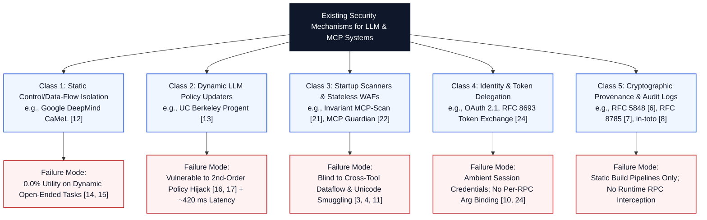

# 03 — Existing Solutions: Architectural Taxonomy of Current Agent & Telemetry Defenses

**Project:** NOSIH (Non-ambient Origin-Scoped Intent Harness)  
**Document Scope:** Detailed architectural examination of existing security mechanisms, protocol gateways, capability frameworks, and provenance standards that address partial facets of the multi-server MCP security problem.

## 1. Taxonomy of Existing Security Mechanisms

Existing defenses against indirect prompt injection, tool poisoning, and unverified telemetry in LLM-integrated applications fall into five distinct architectural classes:

## 2. Class-by-Class Technical Analysis

### 2.1 Class 1: Static Control- and Data-Flow Isolation (Google DeepMind's CaMeL [[12](https://arxiv.org/abs/2503.18813)])
* **Core Mechanism:** CaMeL (*Capabilities for Machine Learning*, Debenedetti et al., 2025 [[12](https://arxiv.org/abs/2503.18813)]) addresses indirect prompt injection [[1](https://arxiv.org/abs/2302.12173)] by splitting the agent into two isolated components:
  1. A **Privileged LLM (P-LLM)** that sees *only* the trusted user prompt $P_0$ and generates a fixed Python-subset execution graph (defining all control flow and tool invocations upfront).
  2. A **Quarantined LLM (Q-LLM)** that parses untrusted data into structured schemas but possesses zero tool-calling privileges and cannot alter the P-LLM's control-flow graph.
* **What It Solves:** When the sequence of required tool calls and sink destinations is completely determinable from the user prompt $P_0$ alone (as in 67% of static tasks in AgentDojo [[18](https://arxiv.org/abs/2406.13352)]), CaMeL provably reduces indirect prompt injection Attack Success Rate (ASR) to **0.0%** [[12](https://arxiv.org/abs/2503.18813)].
* **Where It Fails (The 0.0% Dynamic Utility Cliff):** In open-ended enterprise workflows—such as DevSecOps incident triage, repository debugging, or SOC alert enrichment—the agent must read the output of Tool $A$ (e.g., `github.get_issue`) before it can know *which* file path, database table, or microservice webhook to invoke in Tool $B$. Evaluations on the 2026 **AgentDyn** benchmark (`arXiv:2602.03117` [[14](https://arxiv.org/abs/2602.03117), [15](https://aminrj.com/posts/what-defence-numbers-actually-say/)]) across 60 open-ended dynamic tasks demonstrate that CaMeL's task completion utility drops to **0.0%**, while dual-LLM parsing adds ~680 ms of latency per step.

### 2.2 Class 2: Dynamic LLM Policy Updaters (UC Berkeley's Progent [[13](https://arxiv.org/abs/2504.11703)])
* **Core Mechanism:** Progent (*Programmable Privilege Control for LLM Agents*, Shi et al., 2025/2026 [[13](https://arxiv.org/abs/2504.11703)]) defines a declarative JSON-Schema DSL restricting which tools and argument patterns an agent may invoke. To overcome the static rigidity of CaMeL, Progent invokes an LLM policy updater at runtime whenever intermediate tool outputs arrive, dynamically revising the allowed argument constraints to accommodate newly discovered entities.
* **What It Solves:** Restores dynamic task utility (~52.0%–69.5%) and reduces non-adaptive prompt injection ASR on AgentDojo from 39.9% to 1.0% [[13](https://arxiv.org/abs/2504.11703)].
* **Where It Fails (Second-Order Policy Hijacking):** Because Progent passes untrusted tool outputs into an LLM to update its own security policy, it violates the fundamental separation of control plane and data plane [[1](https://arxiv.org/abs/2302.12173), [2](https://arxiv.org/abs/2211.09527)]. Independent adaptive evaluations by Narisetty et al. (`arXiv:2606.26479` [[16](https://arxiv.org/abs/2606.26479)]) and AutoDojo (`arXiv:2606.15057` [[17](https://arxiv.org/abs/2606.15057)]) proved that adaptive attackers craft **second-order prompt injections** that simultaneously hijack the policy-updating LLM (convincing it to add `https://attacker-c2.io` to the allowed webhook list) and the task LLM, driving adaptive ASR back above **42.0%** while incurring ~420 ms of extra LLM latency per call.

### 2.3 Class 3: Startup Schema Scanners & Stateless WAF Proxies (MCP-Scan [[21](https://invariantlabs.ai/blog/introducing-mcp-scan)] & MCP Guardian [[22](https://www.researchgate.net/publication/391905340_MCP_Guardian_A_Security-First_Layer_for_Safeguarding_MCP-Based_AI_System)])
* **Core Mechanism:**
  * **Invariant Labs' MCP-Scan [[21](https://invariantlabs.ai/blog/introducing-mcp-scan)]:** Inspects MCP server `tools/list` descriptions at initialization for known prompt-injection strings and records static hashes of tool descriptions to flag cross-server shadowing.
  * **MCP Guardian [[22](https://www.researchgate.net/publication/391905340_MCP_Guardian_A_Security-First_Layer_for_Safeguarding_MCP-Based_AI_System)]:** Wraps MCP tool invocations with regex-based WAF heuristics, rate limiting, and manual human-in-the-loop confirmation prompts.
* **What They Solve:** Detect obvious static tool-description poisoning at startup and provide coarse rate limiting.
* **Where They Fail:**
  1. **Blindness to Cross-Tool Runtime Dataflow:** When legitimate Tool $A$ (`github.get_issue`) returns a poisoned issue body that causes the LLM to invoke legitimate Tool $B$ (`webhook.post_webhook`), both tools have clean descriptions. Startup scanners report zero alerts (`>65%` runtime IPI ASR [[11](https://arxiv.org/abs/2508.14925)]).
  2. **Vulnerability to Unicode & Encoding Obfuscation:** Regex WAFs fail when untrusted inputs or outgoing exfiltration payloads use Unicode homoglyphs (UTS #39 [[3](https://www.unicode.org/reports/tr39/)]), invisible tag characters (UTR #36 [[4](https://www.unicode.org/reports/tr36/)]), or Base64/Hex encodings.
  3. **Operator Consent Fatigue:** Prompting human operators to manually approve raw JSON-RPC frames induces rapid alert fatigue (OWASP ASI09 [[10](https://genai.owasp.org/resource/owasp-top-10-for-agentic-applications-for-2026/)]) and aborts multi-step attacker trajectories on Step 1 before the defender can observe the attacker's post-exploitation command-and-control (C2) playbook.

### 2.4 Class 4: Standard OAuth 2.1 & RFC 8693 Token Exchange [[24](https://cruxdigits.nl/blog/ai-agent-identity-authorization-2026/)]
* **Core Mechanism:** Standard enterprise MCP deployments provision MCP servers with static `.env` API keys, service-account credentials, or session-scoped OAuth 2.0/2.1 bearer tokens (including RFC 8693 On-Behalf-Of token exchange) [[24](https://cruxdigits.nl/blog/ai-agent-identity-authorization-2026/)].
* **What They Solve:** Authenticate that the MCP host process is acting on behalf of a specific human user or service account at the coarse API scope level (e.g., `repo:read`, `webhook:write`).
* **Where They Fail (Ambient Authority):** Standard OAuth bearer tokens are **ambient across all tool invocations within a session**. They do not bind token validity to:
  * The cryptographic hash of the user's initial prompt $P_0$,
  * The canonicalized RFC 8785 JCS digest [[7](https://www.rfc-editor.org/rfc/rfc8785)] of the pinned tool schema,
  * The canonicalized digest of the verified tool arguments (`Args_k`), or
  * A positive origin witness proving that a sink parameter (`url`, `path`) was not synthesized from untrusted external text [[23](https://arxiv.org/abs/2606.00485), [24](https://cruxdigits.nl/blog/ai-agent-identity-authorization-2026/)].

### 2.5 Class 5: Cryptographic Provenance & Signed Logging Standards (`in-toto` [[8](https://www.usenix.org/conference/usenixsecurity19/presentation/torres-arias)], RFC 5848 [[6](https://www.rfc-editor.org/rfc/rfc5848)], RFC 8785 [[7](https://www.rfc-editor.org/rfc/rfc8785)])
* **Core Mechanism:**
  * **`in-toto` [[8](https://www.usenix.org/conference/usenixsecurity19/presentation/torres-arias)]:** Enforces supply-chain step verification by chaining signed *materials* (inputs) and *products* (outputs) against a root layout.
  * **RFC 5848 [[6](https://www.rfc-editor.org/rfc/rfc5848)] & NIST SP 800-92 [[5](https://doi.org/10.6028/NIST.SP.800-92)]:** Protect post-hoc log streams using hash chains and digital signature blocks.
  * **RFC 8785 (JCS) [[7](https://www.rfc-editor.org/rfc/rfc8785)]:** Canonicalizes JSON structures for deterministic hashing.
* **What They Solve:** Provide mathematical primitives for tamper-evident logging, deterministic JSON hashing, and multi-step artifact chaining.
* **Where They Fail in Isolation:** None of these standards operate as an inline, sub-2-millisecond JSON-RPC 2.0 agentic interceptor, nor do they track field-level taint provenance, compute Unicode representation diffs ($\Delta(A_{\text{raw}}, A_{\text{model}})$), or perform Value-Erased Foreign-Key Witness joins across dynamic LLM tool calls.

## 3. Summary of Architectural Blind Spots

| Existing Solution Category | Representative System | Primary Strength | Critical Architectural Blind Spot |
| :--- | :--- | :--- | :--- |
| **Static Plan Isolation** | Google DeepMind CaMeL [[12](https://arxiv.org/abs/2503.18813)] | 0.0% ASR on predetermined static plans | **0.0% task utility** on open-ended data-dependent workflows [[14](https://arxiv.org/abs/2602.03117)] |
| **Dynamic LLM Policy Guard** | UC Berkeley Progent [[13](https://arxiv.org/abs/2504.11703)] | Permits runtime policy updates | **Second-order prompt injection** hijacks the policy LLM [[16](https://arxiv.org/abs/2606.26479), [17](https://arxiv.org/abs/2606.15057)]; ~420 ms latency |
| **Startup Schema Scanner** | Invariant MCP-Scan [[21](https://invariantlabs.ai/blog/introducing-mcp-scan)] | Detects static startup tool poisoning | **Blind to runtime cross-tool dataflow** and unauthenticated bearer token replay |
| **Regex / HITL Proxy** | MCP Guardian [[22](https://www.researchgate.net/publication/391905340_MCP_Guardian_A_Security-First_Layer_for_Safeguarding_MCP-Based_AI_System)] | Basic pattern filtering & rate limits | Bypassed by **Unicode confusables / Base64** [[3](https://www.unicode.org/reports/tr39/)]; causes human consent fatigue [[10](https://genai.owasp.org/resource/owasp-top-10-for-agentic-applications-for-2026/)] |
| **Session OAuth / API Keys** | Standard OAuth 2.1 / RFC 8693 [[24](https://cruxdigits.nl/blog/ai-agent-identity-authorization-2026/)] | Coarse client authentication | **Ambient credentials** across calls; zero cryptographic binding to verified RPC arguments |
| **Software Supply-Chain Attestation** | `in-toto` [[8](https://www.usenix.org/conference/usenixsecurity19/presentation/torres-arias)] & RFC 5848 [[6](https://www.rfc-editor.org/rfc/rfc5848)] | Verifiable multi-step hash chains | Designed for static CI/CD builds or passive syslog; **lacks dynamic origin witnessing** |
