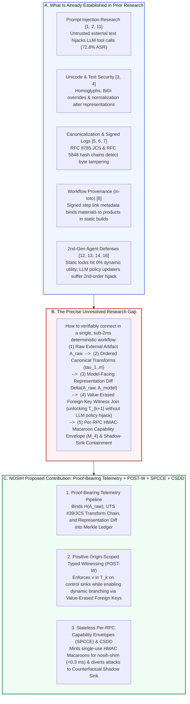

# 05 — Research Gap and Novelty: Connecting Proof-Bearing Telemetry with Positive Origin Witnessing

**Project:** NOSIH (Non-ambient Origin-Scoped Intent Harness)  
**Document Scope:** Formal articulation of what prior literature establishes, the exact unaddressed gap at the intersection of representation security, dynamic agentic control flow, and verifiable telemetry, and how NOSIH's Proof-Bearing Telemetry and three-domain architecture address that gap.

## Overview: From Established Primitives to the Unresolved Synthesis Gap

While individual sub-fields of computer security have developed mature primitives for log integrity, canonical serialization, Unicode normalization, and static information-flow control, our systematic literature review (`02-literature-review.md` and `04-comparative-analysis.md`) demonstrates that no existing framework connects these primitives into a unified, zero-LLM runtime verification pipeline for multi-server Model Context Protocol (MCP) agents.

## A. What Is Already Established?

Based on our primary-source examination in `02-literature-review.md`, four foundational pillars are rigorously established in existing literature:

1. **Cryptographic Digests and Canonical Serialization Detect Tampering Relative to Trusted Values:**
   * IETF RFC 8785 (JSON Canonicalization Scheme — JCS) [[7](https://www.rfc-editor.org/rfc/rfc8785)] establishes that structured JSON artifacts can be serialized deterministically across runtimes so that cryptographic digests (SHA-256, HMAC) remain invariant to whitespace or key-ordering permutations.
   * IETF RFC 5848 (Signed Syslog Messages) [[6](https://www.rfc-editor.org/rfc/rfc5848)] and NIST SP 800-92 [[5](https://doi.org/10.6028/NIST.SP.800-92)] establish that sequential hash chains and digital signature blocks over log records can detect post-hoc modification, deletion, or reordering of recorded security events.
   * Torres-Arias et al. (`in-toto`, USENIX Security 2019) [[8](https://www.usenix.org/conference/usenixsecurity19/presentation/torres-arias)] establish that chaining signed step attestations (*link metadata* binding input *materials* to output *products*) against a declarative *layout* enables end-to-end verification of static software supply-chain workflows.
2. **Unicode Security Standards Document Representation Ambiguities:**
   * Unicode Technical Standard #39 (UTS #39) [[3](https://www.unicode.org/reports/tr39/)] and Unicode Technical Report #36 (UTR #36) [[4](https://www.unicode.org/reports/tr36/)] establish that visual confusables (homoglyphs), bidirectional (BiDi) overrides, invisible tag characters, and non-canonical normalization forms allow adversarial strings to bypass syntactic filters and deceive human reviewers while resolving to active tokens inside downstream parsers.
3. **Indirect Prompt Injection Compromises LLM-Integrated and MCP Applications:**
   * Greshake et al. (2023) [[1](https://arxiv.org/abs/2302.12173)] and Perez & Ribeiro (2022) [[2](https://arxiv.org/abs/2211.09527)] establish that untrusted external content ingested into an LLM's context window reliably induces Goal Hijacking and Prompt Leaking.
   * The MCPTox benchmark (`arXiv:2508.14925`, 2025/2026) [[11](https://arxiv.org/abs/2508.14925)], alongside production CVE disclosures (`CVE-2025-59536`, `CVE-2026-21852`, `CVE-2025-54136`, `CVE-2026-30615`) [[25](https://www.ox.security/blog/mcp-supply-chain-advisory-rce-vulnerabilities-across-the-ai-ecosystem/)], establishes that multi-server MCP agents suffer up to a **72.8% Attack Success Rate** via tool poisoning, cross-tool confused-deputy escalation, and mid-session schema rug pulls [[19](https://arxiv.org/abs/2512.08290), [20](https://www.mdpi.com/2624-800X/6/3/84), [21](https://invariantlabs.ai/blog/introducing-mcp-scan)].
4. **Second-Generation Agent Defenses Face a Documented Security–Utility Cliff:**
   * Static control/data-flow locks (CaMeL [[12](https://arxiv.org/abs/2503.18813)]) eliminate indirect prompt injection on fixed plans but drop to **0.0% task utility** on open-ended, data-dependent tasks in the AgentDyn benchmark (`arXiv:2602.03117` [[14](https://arxiv.org/abs/2602.03117), [15](https://aminrj.com/posts/what-defence-numbers-actually-say/)]).
   * Dynamic LLM policy updaters (Progent [[13](https://arxiv.org/abs/2504.11703)]) restore dynamic branching by invoking an LLM to revise policies at runtime, but Narisetty et al. (`arXiv:2606.26479` [[16](https://arxiv.org/abs/2606.26479)]) and AutoDojo (`arXiv:2606.15057` [[17](https://arxiv.org/abs/2606.15057)]) prove that adaptive attackers inject second-order instructions that hijack the policy-updating LLM itself.

## B. What Precise Gap Are We Investigating?

The precise scientific and engineering gap investigated by NOSIH is:

> **Research Gap Statement:** *Whether a single, zero-LLM deterministic evidence and enforcement workflow at the JSON-RPC 2.0 wire layer can verifiably connect (1) the original untrusted external artifact ($A_{\text{raw}}$), (2) its ordered canonicalization and structural witness transformations ($\tau_1, \dots, \tau_m$), (3) the exact canonicalized representation received by the AI model and security decision engine ($A_{\text{model}}$ and $\text{Args}_k$), and (4) a per-invocation cryptographic capability token verified at the last-mile tool execution boundary—such that open-ended dynamic tool branching is preserved without exposing the security policy engine to untrusted free-text prose or ambient credential replay.*

Specifically, prior work leaves four interconnected gaps unresolved:

1. **The Representation-to-Decision Provenance Gap:** When an MCP read tool ingests an external resource $A_{\text{raw}}$ containing Unicode confusables [[3](https://www.unicode.org/reports/tr39/)], invisible tags [[4](https://www.unicode.org/reports/tr36/)], or non-canonical JSON [[7](https://www.rfc-editor.org/rfc/rfc8785)], existing agent frameworks neither record the ordered transformations applied to $A_{\text{raw}}$ nor compute a cryptographic representation diff $\Delta(A_{\text{raw}}, A_{\text{model}})$ showing how normalization altered the artifact before model inference and policy evaluation.
2. **The Deterministic Dynamic-Branching Gap:** No existing mechanism in the reviewed literature allows an untrusted tool output to dynamically unlock downstream tool arguments *deterministically* (without an LLM policy judge [[13](https://arxiv.org/abs/2504.11703), [16](https://arxiv.org/abs/2606.26479)]) by erasing free-text prose values and joining typed foreign-key fields against a signed local capability manifest.
3. **The Wire-Level Capability Binding Gap:** While `in-toto` [[8](https://www.usenix.org/conference/usenixsecurity19/presentation/torres-arias)] and RFC 5848 [[6](https://www.rfc-editor.org/rfc/rfc5848)] attest to static build steps or passive log entries, no existing MCP defense binds the live runtime verification of positive argument origin ($v \in T_k$) and JCS schema pinning into a single-use HMAC-SHA256 Macaroon envelope (`_meta.nosih_proof`) that gates last-mile credential injection at the MCP server wrapper.
4. **The Post-Block Forensic Visibility Gap:** Existing guardrails that return a hard error (`403 Forbidden`) either trigger operator consent fatigue (OWASP ASI09 [[10](https://genai.owasp.org/resource/owasp-top-10-for-agentic-applications-for-2026/)]) or terminate the session on Step 1, blinding defenders to the attacker's multi-step C2 trajectory and failing to synthesize a minimal-cut policy remediation diff.

## C. What Is Our Proposed Contribution?

To address this gap, NOSIH introduces **Proof-Bearing Telemetry** integrated with three deterministic enforcement innovations across Program Analysis, Applied Cryptography, and Deception Engineering:

### 1. Proof-Bearing Telemetry & Canonical Representation Diffing
For every external artifact ingested and every `tools/call` evaluated, NOSIH constructs a verifiable evidence record $\mathcal{E}_k$ grounded in RFC 8785 [[7](https://www.rfc-editor.org/rfc/rfc8785)], UTS #39/UTR #36 [[3](https://www.unicode.org/reports/tr39/), [4](https://www.unicode.org/reports/tr36/)], RFC 5848 [[6](https://www.rfc-editor.org/rfc/rfc5848)], and `in-toto` [[8](https://www.usenix.org/conference/usenixsecurity19/presentation/torres-arias)]:
* **Raw Evidence Capture:** Computes $H_{\text{raw}} = \text{SHA256}(A_{\text{raw}})$ over the exact unparsed byte stream returned by any external MCP server.
* **Ordered Transformation Provenance:** Records the ordered sequence of canonical transformations $\tau_1$ (UTF-8 validation & UTR #36 invisible/BiDi stripping [[4](https://www.unicode.org/reports/tr36/)]), $\tau_2$ (UTS #39 NFKC/confusable skeleton mapping [[3](https://www.unicode.org/reports/tr39/)]), $\tau_3$ (RFC 8785 JCS canonicalization [[7](https://www.rfc-editor.org/rfc/rfc8785)]), and $\tau_4$ (Value-Erased Foreign-Key extraction).
* **Representation-Difference Reporting:** Computes a structured diff object $\Delta(A_{\text{raw}}, A_{\text{model}})$ quantifying exact character substitutions, stripped BiDi/tag code points, and canonicalized JSON keys, flagging any non-zero covert representation discrepancy before policy evaluation.
* **Verifiable Merkle Evidence Record:** Appends each step's `in-toto`-style link attestation and HMAC-Macaroon signature $M_4$ into an append-only SHA-256 Merkle tree (`MerkleRoot_k`), enabling offline third-party verification.

### 2. Positive Origin-Scoped Typed Witnessing (`POST-W`)
Replaces fragile negative substring taint guessing and vulnerable LLM policy updaters [[13](https://arxiv.org/abs/2504.11703), [16](https://arxiv.org/abs/2606.26479)] with a deterministic set-membership invariant:
* **Positive Origin Set ($T_k$):** Initialized at session start from the signed user prompt and declarative manifest: $T_0 = \text{ExtractEntities}(P_0) \cup \text{Flatten}(\texttt{nosih.yaml})$.
* **Default-Deny Positive Origin Lock:** Any parameter annotated as a `control_sink` (URLs, file paths, shell commands, recipients) is permitted if and only if its canonicalized value satisfies $v \in T_k$.
* **Dynamic Branching via Value-Erased Foreign-Key Witnesses:** When an untrusted tool returns JSON, `POST-W` erases all free-text prose and executes a deterministic **Typed Foreign-Key Join** against `trusted_catalog` in `nosih.yaml`, unlocking pre-trusted capability attributes into $T_{k+1}$ without exposing the policy engine to untrusted text.
* **Dual Data-Plane Leak Guard:** Registers rolling 5-gram shingles and canonical encodings (raw, Base64, hex, URL-encoded) from `HIGH_CONFIDENTIALITY` sources (`.env`, SSH keys) to block unauthorized exfiltration across outbound network tools.

### 3. Stateless Per-RPC Cryptographic Capability Envelopes (`SPCCE`) & Counterfactual Shadow-Sink Deception (`CSDD`)
* **SPCCE (`_meta.nosih_proof`):** Pins tool schemas at boot via RFC 8785 JCS SHA-256 digests (`schema_lock`), mints a single-use 5-stage HMAC-SHA256 Macaroon ($M_0 \to M_4$) per approved tool call, and performs last-mile vaulted credential injection inside `nosih-shim` in $<0.3\text{ ms}$.
* **CSDD (Counterfactual Shadow Sink & One-Click Policy Diff):** Computes a bipartite privilege graph Blast-Radius Score ($0\text{–}10$) and transparently routes unauthorized or high-blast-radius calls into an in-memory copy-on-write virtual filesystem and loopback webhook trap, returning a synthetic `200 OK` receipt to capture the full attacker kill chain while generating a visual Causal Origin Diff and minimal-cut `nosih.yaml` patch.

## D. Distinguishing NOSIH from Existing Work Across Explicit Criteria

To verify whether this combination contributes a meaningful architectural advance over prior work, the table below evaluates NOSIH against the closest identified systems across eight explicit verification criteria:

| Explicit Verification Criterion | Greshake / MCPTox [[1](https://arxiv.org/abs/2302.12173), [11](https://arxiv.org/abs/2508.14925)] | UTS #39 / RFC 8785 [[3](https://www.unicode.org/reports/tr39/), [7](https://www.rfc-editor.org/rfc/rfc8785)] | RFC 5848 / `in-toto` [[6](https://www.rfc-editor.org/rfc/rfc5848), [8](https://www.usenix.org/conference/usenixsecurity19/presentation/torres-arias)] | CaMeL (DeepMind) [[12](https://arxiv.org/abs/2503.18813)] | Progent (Berkeley) [[13](https://arxiv.org/abs/2504.11703)] | MCP-Scan / Guardian [[21](https://invariantlabs.ai/blog/introducing-mcp-scan), [22](https://www.researchgate.net/publication/391905340_MCP_Guardian_A_Security-First_Layer_for_Safeguarding_MCP-Based_AI_System)] | **NOSIH (POST-W + SPCCE + CSDD + Proof-Bearing Telemetry)** |
| :--- | :---: | :---: | :---: | :---: | :---: | :---: | :---: |
| **1. Raw-Artifact Integrity ($H(A_{\text{raw}})$)** | ❌ | ❌ | ✅ (Static files/logs) | ❌ | ❌ | ❌ | **✅ (Per-RPC raw payload SHA-256 capture)** |
| **2. Ordered Transformation Provenance ($\tau_1..\tau_m$)** | ❌ | ❌ | ✅ (CI/CD build steps) | ❌ | ❌ | ❌ | **✅ (`in-toto`-style link chain per transform)** |
| **3. Representation-Difference Reporting ($\Delta(A_{\text{raw}}, A_{\text{model}})$)** | ❌ | ⚠️ (Static rules only) | ❌ | ❌ | ❌ | ❌ | **✅ (UTS #39/UTR #36 + JCS diff telemetry)** |
| **4. Deterministic Dynamic Branching Under Untrusted Input** | ❌ | ❌ | ❌ | ❌ (0% AgentDyn [[14](https://arxiv.org/abs/2602.03117)]) | ❌ (Uses vulnerable LLM [[16](https://arxiv.org/abs/2606.26479)]) | ❌ (Unprotected) | **✅ (Value-Erased Foreign-Key Witness Join)** |
| **5. Positive Origin Lock on Control Sinks ($v \in T_k$)** | ❌ | ❌ | ❌ | ✅ (Static $T_0$ only) | ⚠️ (Mutable by LLM) | ❌ | **✅ (Deterministic $T_k$ set membership lock)** |
| **6. Per-RPC Capability Envelope & Zero Ambient Keys** | ❌ | ❌ | ❌ | ❌ | ❌ | ❌ | **✅ (Chained HMAC-SHA256 Macaroon $M_4$ + Shim)** |
| **7. Tamper Detection & Independent Offline Verification** | ❌ | ✅ (JCS digest) | ✅ (Signed log/layout) | ❌ | ❌ | ⚠️ (Startup pin only) | **✅ (Merkle Provenance Ledger + JCS Proof Export)** |
| **8. Deceptive C2 Trajectory Capture & Policy Diffing** | ❌ | ❌ | ❌ | ❌ (Hard abort) | ❌ (Hard abort) | ❌ (Hard abort) | **✅ (Counterfactual Shadow Sink & Minimal-Cut Diff)** |

### Formal Novelty Statement
As evidenced by the comparative matrix above, while each underlying mathematical primitive—JSON canonicalization [[7](https://www.rfc-editor.org/rfc/rfc8785)], Unicode confusable normalization [[3](https://www.unicode.org/reports/tr39/)], signed syslog chains [[6](https://www.rfc-editor.org/rfc/rfc5848)], `in-toto` step attestations [[8](https://www.usenix.org/conference/usenixsecurity19/presentation/torres-arias)], and capability macaroons—is individually established in its home domain, **existing literature does not combine Proof-Bearing Telemetry (connecting raw artifacts, representation diffs, and ordered transformations) with Value-Erased Foreign-Key Witnessing (`POST-W`), per-RPC HMAC-Macaroon capability attenuation (`SPCCE`), and Counterfactual Shadow-Sink Deception (`CSDD`) at the MCP JSON-RPC 2.0 wire layer.** This synthesis directly resolves the 2026 Security–Utility–Verifiability Trilemma without introducing secondary LLM latency or second-order injection surfaces.
