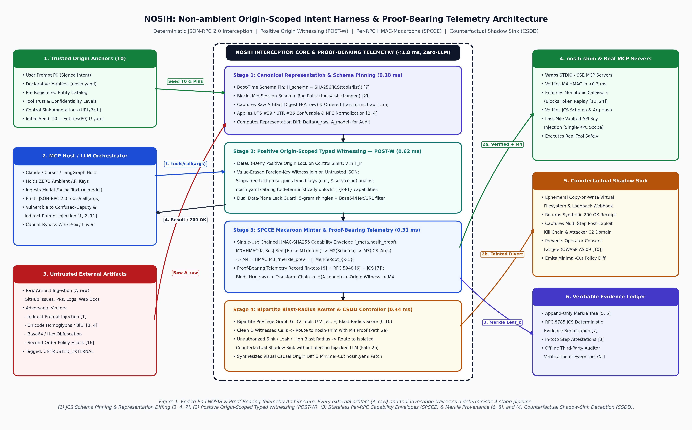
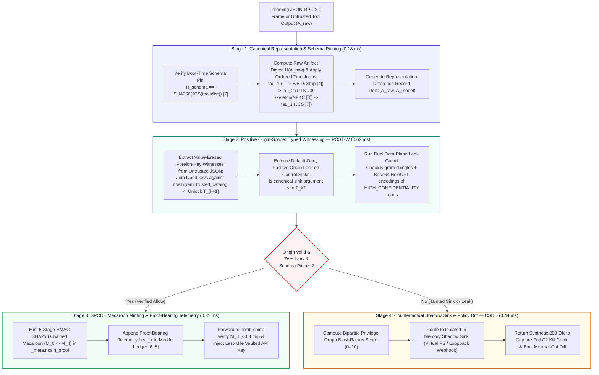

# 06 — Proposed Framework: NOSIH & Proof-Bearing Telemetry Architecture

**Project:** NOSIH (Non-ambient Origin-Scoped Intent Harness)  
**Document Scope:** Complete mathematical, cryptographic, and wire-protocol specification of NOSIH, integrating Proof-Bearing Telemetry with Positive Origin-Scoped Typed Witnessing (`POST-W`), Stateless Per-RPC Capability Envelopes (`SPCCE`), and Counterfactual Shadow-Sink Deception (`CSDD`).

## 1. End-to-End Architectural Overview

NOSIH operates as a transparent, zero-LLM-overhead JSON-RPC 2.0 security harness positioned at the wire boundary between any Model Context Protocol (MCP) Host/Client (e.g., Claude Desktop, Cursor, Windsurf, LangGraph) and any local (`STDIO`) or remote (`HTTP/SSE`) MCP Server.



### 1.1 Four-Stage Deterministic Interception Pipeline



## 2. Core Innovation 1: Proof-Bearing Telemetry & Canonical Representation Diffing

To bridge the forensic gap between raw external content and model-driven tool calls, NOSIH implements **Proof-Bearing Telemetry** grounded in IETF RFC 8785 [[7](https://www.rfc-editor.org/rfc/rfc8785)], Unicode UTS #39/UTR #36 [[3](https://www.unicode.org/reports/tr39/), [4](https://www.unicode.org/reports/tr36/)], IETF RFC 5848 [[6](https://www.rfc-editor.org/rfc/rfc5848)], and `in-toto` [[8](https://www.usenix.org/conference/usenixsecurity19/presentation/torres-arias)].

### 2.1 Ordered Transformation Pipeline ($\tau_1 \circ \tau_2 \circ \tau_3 \circ \tau_4$)
Whenever an MCP tool returns an external artifact $A_{\text{raw}}$, NOSIH records an `in-toto`-style step link attestation [[8](https://www.usenix.org/conference/usenixsecurity19/presentation/torres-arias)] for each deterministic transformation before the artifact reaches the model context ($A_{\text{model}}$) or the policy engine:

1. **Raw Evidence Capture ($\tau_0$):** Computes the cryptographic digest of the raw byte stream as received over the wire:
   $$H_{\text{raw}} = \text{SHA256}(A_{\text{raw}})$$
2. **Invisible & Bidirectional Control Sanitization ($\tau_1$ — UTR #36 [[4](https://www.unicode.org/reports/tr36/)]):** Strips invisible format characters, zero-width joiners (`U+200B`–`U+200D`), Unicode tag characters (`U+E0000`–`U+E007F`), and bidirectional overrides (`U+202A`–`U+202E`, `U+2066`–`U+2069`), producing $A_1 = \tau_1(A_{\text{raw}})$ and digest $H_1 = \text{SHA256}(A_1)$.
3. **Unicode Normalization & Confusable Skeleton Mapping ($\tau_2$ — UTS #39 [[3](https://www.unicode.org/reports/tr39/)]):** Applies Unicode Normalization Form KC (`NFKC`) to model-facing strings and computes the UTS #39 `skeleton(X)` over all candidate identifiers, URLs, and file paths to detect cross-script homoglyph substitution (e.g., Cyrillic `а` `U+0430` vs. Latin `a` `U+0061`), producing $A_2 = \tau_2(A_1)$ and digest $H_2 = \text{SHA256}(A_2)$.
4. **RFC 8785 JSON Canonicalization Scheme ($\tau_3$ — JCS [[7](https://www.rfc-editor.org/rfc/rfc8785)]):** Serializes structured JSON payloads with lexicographically sorted UTF-16 keys, ECMAScript IEEE 754 numeric representations, and stripped whitespace, yielding the canonical model-facing artifact $A_{\text{model}} = \text{JCS}(A_2)$ and digest $H_{\text{model}} = \text{SHA256}(A_{\text{model}})$.

### 2.2 Representation-Difference Record ($\Delta(A_{\text{raw}}, A_{\text{model}})$)
NOSIH computes and logs a structured Representation-Difference vector:
$$\Delta(A_{\text{raw}}, A_{\text{model}}) = \langle \text{count}_{\text{BiDi}}, \text{count}_{\text{tags}}, \text{set}_{\text{homoglyphs}}, \text{edit\_distance}(A_{\text{raw}}, A_{\text{model}}), H_{\text{raw}}, H_{\text{model}} \rangle$$
If $\text{count}_{\text{BiDi}} > 0$, $\text{count}_{\text{tags}} > 0$, or mixed-script confusables are detected inside a structural identifier, NOSIH flags a `REPRESENTATION_SMUGGLING_ALERT` in the telemetry ledger.

## 3. Core Innovation 2: Positive Origin-Scoped Typed Witnessing (`POST-W`)

`POST-W` eliminates both the 0.0% dynamic utility cliff of static plan locks (CaMeL [[12](https://arxiv.org/abs/2503.18813), [14](https://arxiv.org/abs/2602.03117)]) and the second-order policy injection flaw of LLM policy updaters (Progent [[13](https://arxiv.org/abs/2504.11703), [16](https://arxiv.org/abs/2606.26479)]).

### 3.1 Formal Positive Origin Invariant
1. **Trusted Origin Seed ($T_0$):** At session initialization, NOSIH constructs the initial Trusted Origin Set from the signed user prompt $P_0$ and the declarative manifest `nosih.yaml`:
   $$T_0 = \text{ExtractEntities}(\text{NFKC}(P_0)) \cup \text{FlattenLiterals}(\texttt{nosih.yaml})$$
2. **Default-Deny Control Sink Lock:** For any tool invocation $T_k(\text{Args}_k)$ where parameter $p$ is declared in `nosih.yaml` as a `control_sink` (destination URLs, file write/read paths, shell commands, SQL queries, email recipients), `POST-W` enforces:
   $$\text{Permit}(T_k, p, v) \iff \text{Canonicalize}_{\text{JCS+UTS39}}(v) \in T_k$$
   Because an attacker-injected endpoint such as `https://attacker-c2.io/collect` is not in $T_k$, it can **never** pass `POST-W` validation regardless of how the LLM paraphrases, translates, or obfuscates the untrusted text.

### 3.2 Dynamic Branching via Value-Erased Foreign-Key Witnesses
To enable open-ended data-dependent workflows (where the agent must inspect the output of an untrusted tool to determine which service or file to inspect next [[14](https://arxiv.org/abs/2602.03117)]), `POST-W` implements **Value-Erased Foreign-Key Joins**:
1. When an untrusted tool (e.g., `github_issues.get_issue`) returns a canonicalized JSON object $J$, `POST-W` **erases all free-text prose values** (such as `issue.body` or `issue.comments`) before policy evaluation.
2. `POST-W` evaluates only pre-declared JSONPath extractors specified in `nosih.yaml` (e.g., `$.service_id`).
3. If the extracted key $k_{\text{fk}} = \text{"payments-api"}$ matches an entry in the signed `trusted_catalog.services` dictionary in `nosih.yaml`, `POST-W` deterministically expands the Trusted Origin Set for step $k+1$:
   $$T_{k+1} = T_k \cup \{\texttt{"./configs/payments\_diag.yaml"}, \texttt{"https://hooks.internal.acme.org/payments-triage"}\}$$
   Untrusted external data can **select among pre-trusted capabilities via typed foreign keys**, but can **never invent arbitrary sink targets or inject natural-language instructions into the policy engine**.

### 3.3 Dual Data-Plane Sensitive Leak Guard
Simultaneously, whenever the agent reads from a resource tagged `HIGH_CONFIDENTIALITY` (such as `.env`, SSH keys, or credential stores), `POST-W` extracts rolling 5-gram character shingles and canonical encodings (`raw`, `Base64`, `hex`, `URL-encoded`) into an active **Sensitive Data Filter**, blocking any outbound network tool from transmitting high-confidentiality tokens even if the destination URL is an authorized internal webhook.

## 4. Core Innovation 3: Stateless Per-RPC Cryptographic Capability Envelopes (`SPCCE`)

To eliminate ambient `.env` credentials and prevent mid-session schema rug pulls [[21](https://invariantlabs.ai/blog/introducing-mcp-scan), [24](https://cruxdigits.nl/blog/ai-agent-identity-authorization-2026/)], `SPCCE` enforces cryptographic capability binding at the wire layer:

### 4.1 Boot-Time JCS Schema Pinning (`schema_lock`)
Upon MCP server initialization, NOSIH intercepts the `tools/list` response, canonicalizes each tool's `name`, `description`, and `inputSchema` via RFC 8785 JCS [[7](https://www.rfc-editor.org/rfc/rfc8785)], and records:
$$H_{\text{schema}}(\text{Tool}_i) = \text{SHA256}(\text{JCS}(\text{Schema}(\text{Tool}_i)))$$
Any mid-session `notifications/tools/list_changed` mutation or unannounced schema modification triggers an immediate `SCHEMA_PIN_MISMATCH` circuit breaker.

### 4.2 Five-Stage Chained HMAC-SHA256 Macaroon (`_meta.nosih_proof`)
When `POST-W` approves the $k$-th tool invocation, the NOSIH interception core mints a stateless, single-use capability envelope chained to the session's Merkle provenance history:

$$\begin{aligned}
M_0 &= \text{HMAC\_SHA256}(K_{\text{master}}, \text{SessionID} \parallel \text{CallSeq}_k \parallel \text{Timestamp}_k) \\
M_1 &= \text{HMAC\_SHA256}(M_0, \texttt{"origin\_intent="} \parallel \text{SHA256}(\text{NFKC}(P_0))) \\
M_2 &= \text{HMAC\_SHA256}(M_1, \texttt{"schema\_lock="} \parallel H_{\text{schema}}(\text{Tool}_k)) \\
M_3 &= \text{HMAC\_SHA256}(M_2, \texttt{"verified\_args="} \parallel \text{SHA256}(\text{JCS}(\text{Args}_k))) \\
M_4 &= \text{HMAC\_SHA256}(M_3, \texttt{"merkle\_prev="} \parallel \text{MerkleRoot}_{k-1})
\end{aligned}$$

The lightweight `nosih-shim` wrapping the downstream MCP server verifies $M_4$ in $<0.3\text{ ms}$, confirms $\text{CallSeq}_k > \text{LastSeenSeq}$ (preventing replay), injects the vaulted API credential solely for that single RPC execution, and appends $\text{MerkleRoot}_k = \text{SHA256}(\text{MerkleRoot}_{k-1} \parallel \text{JCS}(\mathcal{E}_k) \parallel M_4)$ to the verifiable evidence ledger.

## 5. Core Innovation 4: Counterfactual Shadow-Sink Deception & Policy Diff (`CSDD`)

When `POST-W` flags an unauthorized sink parameter or sensitive data leak, returning a hard `403 Forbidden` error causes two operational failures: (1) human operators are prompted to override the block, inducing consent fatigue (OWASP ASI09 [[10](https://genai.owasp.org/resource/owasp-top-10-for-agentic-applications-for-2026/)]), and (2) the multi-step attack aborts immediately, hiding the attacker's post-exploitation playbook. `CSDD` resolves both via:

1. **Bipartite Privilege Blast-Radius Scoring:** Models all connected MCP servers, tools, and resources as a bipartite graph $G = (V_{\text{tools}} \cup V_{\text{resources}}, E)$ and computes the reachable risk score:
   $$\text{BlastRadius}(T_k) = \min\left(10.0, \sum_{v \in \text{Reachable}(T_k)} w_{\text{conf}}(v) \cdot w_{\text{integ}}(v)\right)$$
2. **Transparent Counterfactual Shadow Redirection:** Routes the blocked call to an isolated in-memory **Counterfactual Shadow Sink** (an ephemeral copy-on-write virtual file table and loopback webhook listener) that returns a realistic synthetic `200 OK` JSON receipt to the hijacked LLM. Believing its action succeeded, the hijacked agent exposes its complete multi-step C2 trajectory inside the sandbox while real production assets remain untouched.
3. **One-Click Minimal-Cut Policy Diff:** For legitimate edge-case workflows blocked by default-deny, `CSDD` generates a visual **Causal Origin & Representation Diff** pinpointing the exact upstream JSON field that triggered the block and synthesizes a minimal-cut `nosih.yaml` policy patch for auditor review.

## 6. Declarative Manifest (`nosih.yaml`) & Wire Envelope Specifications

### 6.1 Declarative Manifest Schema (`nosih.yaml`)
```yaml
version: "1.0"
session_policy:
  mode: "shadow_quarantine"        # Options: shadow_quarantine | strict_block
  unicode_profile: "UTS39_STRICT"  # Enforces NFKC + UTS #39 confusable skeleton check
  canonicalization: "RFC8785_JCS"  # Deterministic JSON Canonicalization Scheme
  max_blast_radius: 6.5

servers:
  github_issues:
    command: ["python3", "servers/github_mcp.py"]
    trust_level: "UNTRUSTED_EXTERNAL"
    tools:
      get_issue:
        confidentiality: "PUBLIC"
        typed_witness_extractors:
          - json_path: "$.service_id"
            lookup_table: "trusted_catalog.services"

  workspace_fs:
    command: ["python3", "servers/fs_mcp.py"]
    trust_level: "TRUSTED_INTERNAL"
    tools:
      read_file:
        control_sinks: ["path"]
        confidentiality_rules:
          - pattern: "*.env*"
            level: "HIGH_CONFIDENTIALITY"
      write_file:
        control_sinks: ["path"]
        integrity_weight: 9.0

  webhook_notifier:
    command: ["python3", "servers/webhook_mcp.py"]
    vault_env_inject:
      WEBHOOK_BEARER_TOKEN: "vault://secrets/prod_webhook_token"
    tools:
      post_webhook:
        control_sinks: ["url"]
        exfiltration_sink: true
        integrity_weight: 8.5

trusted_catalog:
  services:
    payments-api:
      path: "./configs/payments_diag.yaml"
      url: "https://hooks.internal.acme.org/payments-triage"
    auth-service:
      path: "./configs/auth_diag.yaml"
      url: "https://hooks.internal.acme.org/auth-triage"
```

### 6.2 Wire-Level JSON-RPC 2.0 Capability & Proof-Bearing Telemetry Envelope
```json
{
  "jsonrpc": "2.0",
  "id": 42,
  "method": "tools/call",
  "params": {
    "name": "post_webhook",
    "arguments": {
      "summary": "Diagnostic check completed for payments-api: status nominal.",
      "url": "https://hooks.internal.acme.org/payments-triage"
    },
    "_meta": {
      "nosih_proof": {
        "session_id": "ses_9f82a1c4",
        "call_seq": 3,
        "timestamp": 1792241560,
        "intent_hash": "e3b0c44298fc1c149afbf4c8996fb92427ae41e4649b934ca495991b7852b855",
        "schema_pin_hash": "8f434346648f6b96df89dda901c5176b10a6d83961dd3c1ac88b59b2dc327aa4",
        "verified_args_hash": "2c26b46b68ffc68ff99b453c1d30413413422d706483bfa0f98a5e886266e7ae",
        "raw_artifact_hash": "9a1c72b83e04d19f221b5c8a7d6e5f4a3b2c1d0e9f8a7b6c5d4e3f2a1b0c9d8e",
        "model_facing_hash": "7f8e9d0c1b2a3f4e5d6c7b8a9f0e1d2c3b4a5f6e7d8c9b0a1f2e3d4c5b6a7f8e",
        "representation_diff": {
          "bidi_stripped": 0,
          "unicode_tags_stripped": 0,
          "uts39_confusables_detected": 0,
          "jcs_canonicalized": true
        },
        "origin_witness": "trusted_catalog.services[payments-api].url",
        "merkle_parent_root": "4b227777d4dd1fc61c6f884f48641d02b4d121d3fd328cb08b5531fcacdabf8a",
        "macaroon_hmac": "d4735e3a265e16eee03f59718b9b5d03019c07d8b6c51f90da3a666eec13ab35"
      }
    }
  }
}
```
