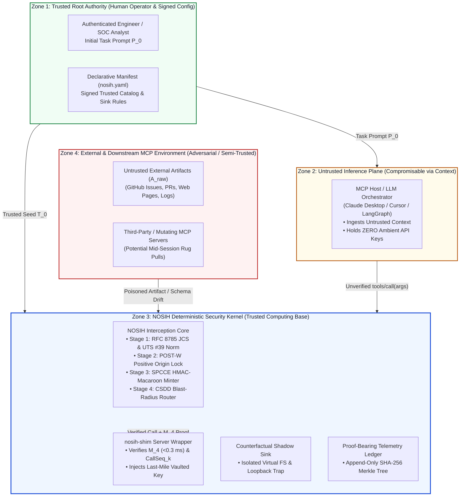

# 07 — Threat Model: Adversary Capabilities, Trust Boundaries, and Security Assumptions

**Project:** NOSIH (Non-ambient Origin-Scoped Intent Harness)  
**Document Scope:** Formal threat model defining the system trust boundaries, adversary capabilities, attack surfaces across the Model Context Protocol (MCP) lifecycle, explicit security assumptions, and out-of-scope residual risks.

## 1. System Trust Boundaries & Architectural Zones

NOSIH partitions an enterprise MCP agent deployment into four distinct security zones separated by cryptographic and OS process boundaries:

## 2. Adversary Capabilities (Dolev-Yao Adaptive Agentic Threat Model)

We assume a strong, adaptive adversary operating across external data sources, third-party tool ecosystems, and compromised sub-agent processes:

1. **Full Control Over External Data Artifacts ($A_{\text{raw}}$):**
   * The adversary can craft arbitrary natural-language instructions, delimiter escape sequences [[2](https://arxiv.org/abs/2211.09527)], indirect prompt injections [[1](https://arxiv.org/abs/2302.12173), [11](https://arxiv.org/abs/2508.14925)], and adaptive second-order policy-hijacking payloads [[16](https://arxiv.org/abs/2606.26479), [17](https://arxiv.org/abs/2606.15057)] inside external resources retrieved by MCP read tools (e.g., GitHub issues, pull requests, Jira tickets, emails, web pages, and application log lines).
2. **Unicode, Encoding, and Serialization Manipulation:**
   * The adversary can embed Unicode visual confusables/homoglyphs (UTS #39 [[3](https://www.unicode.org/reports/tr39/)]), bidirectional override control characters (`U+202E`), invisible tag characters (`U+E0000`–`U+E007F`, UTR #36 [[4](https://www.unicode.org/reports/tr36/)]), non-canonical JSON key ordering/whitespace [[7](https://www.rfc-editor.org/rfc/rfc8785)], and multi-layer encodings (Base64, hex, URL-encoding, semantic paraphrasing) to evade regex filters and substring taint trackers.
3. **Control Over Malicious or Compromised Third-Party MCP Servers:**
   * The adversary can deploy or compromise a third-party MCP server that passes initial startup inspection (`MCP-Scan` [[21](https://invariantlabs.ai/blog/introducing-mcp-scan)]) and subsequently executes a **mid-session schema rug pull** via `notifications/tools/list_changed` or attempts **cross-server tool shadowing** [[19](https://arxiv.org/abs/2512.08290), [20](https://www.mdpi.com/2624-800X/6/3/84)].
4. **Compromised Sub-Agent & Direct Wire Replay:**
   * The adversary can hijack a worker sub-agent in a multi-agent cluster [[10](https://genai.owasp.org/resource/owasp-top-10-for-agentic-applications-for-2026/), [24](https://cruxdigits.nl/blog/ai-agent-identity-authorization-2026/)] and attempt to invoke an MCP server directly over IPC/HTTP without passing through the LLM, or attempt to replay a previously captured JSON-RPC request frame and capability token (`_meta.nosih_proof`).
5. **Post-Incident Log Tampering Attempts:**
   * The adversary may attempt to alter, delete, or reorder local plaintext log files to hide which external artifact triggered an unauthorized tool invocation [[5](https://doi.org/10.6028/NIST.SP.800-92), [6](https://www.rfc-editor.org/rfc/rfc5848)].

## 3. Comprehensive Attack Surface & Mitigation Mapping

| Threat ID | Attack Vector & Mechanism | Standards & Literature Mapping | NOSIH Deterministic Defense Mechanism |
| :--- | :--- | :--- | :--- |
| **TM-01** | **Cross-Tool Indirect Prompt Injection (Confused Deputy):** Untrusted issue text instructs the LLM to invoke `post_webhook` or `write_file` targeting an attacker-controlled URL or file path. | Greshake et al. [[1](https://arxiv.org/abs/2302.12173)]; MCPTox [[11](https://arxiv.org/abs/2508.14925)]; OWASP ASI01/ASI02 [[10](https://genai.owasp.org/resource/owasp-top-10-for-agentic-applications-for-2026/)]; Confused ChatGPT [[23](https://arxiv.org/abs/2606.00485)] | **POST-W Positive Origin Lock:** Enforces $v \in T_k$ on all `control_sink` parameters. Attacker URLs/paths are never in $T_k$ and are diverted to the Shadow Sink. |
| **TM-02** | **Adaptive Second-Order Policy Hijacking:** Payload inside untrusted tool output attempts to convince a dynamic policy updater to expand allowed tool permissions. | Progent [[13](https://arxiv.org/abs/2504.11703)]; Narisetty et al. [[16](https://arxiv.org/abs/2606.26479)]; AutoDojo [[17](https://arxiv.org/abs/2606.15057)] | **Zero-LLM Critical Path & Value-Erased Joins:** NOSIH strips all free-text prose and updates $T_{k+1}$ exclusively via deterministic foreign-key joins against `nosih.yaml`. |
| **TM-03** | **Unicode Homoglyph, BiDi & Tag Smuggling:** Attacker uses Cyrillic homoglyphs or invisible Unicode tags to spoof trusted identifiers or hide instructions from human auditors. | Unicode UTS #39 [[3](https://www.unicode.org/reports/tr39/)]; Unicode UTR #36 [[4](https://www.unicode.org/reports/tr36/)] | **Stage 1 Canonical Representation Engine:** Strips UTR #36 BiDi/tag code points, applies `NFKC` + UTS #39 confusable skeleton mapping, and logs $\Delta(A_{\text{raw}}, A_{\text{model}})$. |
| **TM-04** | **Mid-Session Schema "Rug Pull" & Tool Shadowing:** MCP server mutates its `tools/list` description or `inputSchema` after registration to inject hidden parameters. | Invariant Labs [[21](https://invariantlabs.ai/blog/introducing-mcp-scan)]; SoK MCP [[19](https://arxiv.org/abs/2512.08290)]; OWASP ASI04 [[10](https://genai.owasp.org/resource/owasp-top-10-for-agentic-applications-for-2026/)] | **Boot-Time JCS Schema Pinning (`schema_lock`):** Binds $H_{\text{schema}} = \text{SHA256}(\text{JCS}(\text{Schema}))$ into Macaroon step $M_2$; blocks any mid-session schema drift. |
| **TM-05** | **Ambient Credential Theft & Token Replay:** Compromised sub-agent calls MCP server directly or replays a captured `_meta.nosih_proof` envelope to re-execute a privileged tool. | OWASP ASI03 [[10](https://genai.owasp.org/resource/owasp-top-10-for-agentic-applications-for-2026/)]; OWASP NHI Top 10 / Crux Digits [[24](https://cruxdigits.nl/blog/ai-agent-identity-authorization-2026/)]; CVEs [[25](https://www.ox.security/blog/mcp-supply-chain-advisory-rce-vulnerabilities-across-the-ai-ecosystem/)] | **SPCCE Macaroon + Last-Mile Vault:** MCP host holds zero API keys; `nosih-shim` verifies $M_4$, checks strictly monotonic `CallSeq_k`, and injects credentials per-RPC. |
| **TM-06** | **Encoded Secret Exfiltration Over Allowed Sinks:** Hijacked agent Base64- or hex-encodes `.env` secrets and posts them to a legitimate internal webhook URL ($v \in T_k$). | Perez & Ribeiro [[2](https://arxiv.org/abs/2211.09527)]; OWASP LLM02 [[9](https://genai.owasp.org/llm-top-10/)] | **Dual Data-Plane Sensitive Leak Guard:** Indexes rolling 5-gram shingles and canonical encodings (`raw`, `Base64`, `hex`, `URL`) of `HIGH_CONFIDENTIALITY` reads. |
| **TM-07** | **Operator Consent Fatigue & Blind Error Loops:** Repeated guardrail confirmation popups trick operators into clicking "Allow" or abort multi-step attacks before C2 attribution. | OWASP ASI09 (Human-Agent Trust Exploitation) [[10](https://genai.owasp.org/resource/owasp-top-10-for-agentic-applications-for-2026/)] | **Counterfactual Shadow Sink (`CSDD`):** Silently diverts tainted calls to an in-memory virtual FS/webhook trap, returning synthetic `200 OK` and capturing the full kill chain. |
| **TM-08** | **Forensic Log Forgery & JSON Serialization Mismatch:** Attacker alters local logs or exploits JSON whitespace/key-order differences between proxy and verifier. | NIST SP 800-92 [[5](https://doi.org/10.6028/NIST.SP.800-92)]; RFC 5848 [[6](https://www.rfc-editor.org/rfc/rfc5848)]; RFC 8785 [[7](https://www.rfc-editor.org/rfc/rfc8785)]; `in-toto` [[8](https://www.usenix.org/conference/usenixsecurity19/presentation/torres-arias)] | **Proof-Bearing Telemetry Ledger:** Canonicalizes all JSON via RFC 8785 JCS and chains step attestations into an append-only SHA-256 Merkle tree. |

## 4. Explicit Security Assumptions

For NOSIH's cryptographic and information-flow guarantees to hold, the deployment must satisfy four explicit assumptions:

1. **Process & Memory Isolation of the NOSIH TCB (Trusted Computing Base):**
   * The NOSIH interception proxy, the `MasterKey` ($K_{\text{master}}$) used to mint `SPCCE` HMAC-Macaroons, and the credential vault reside in an OS process or container memory space isolated from the untrusted LLM orchestrator and third-party MCP servers.
2. **Integrity of the Initial User Prompt ($P_0$) and Declarative Manifest (`nosih.yaml`):**
   * The human operator's initial task prompt $P_0$ and the workspace `nosih.yaml` configuration file are assumed to be authored or approved by an authorized principal prior to session initialization (analogous to the trusted root *layout* in `in-toto` [[8](https://www.usenix.org/conference/usenixsecurity19/presentation/torres-arias)]).
3. **Mediated Transport via `nosih-shim`:**
   * All side-effecting MCP servers are wrapped by `nosih-shim` (automatically configured via `nosih wrap`) so that third-party API credentials are never exposed in plaintext `.env` files accessible to the agent host.
4. **Payload & Memory Bounds (NFR-04):**
   * Individual JSON-RPC frames and per-session Counterfactual Shadow-Sink state tables are strictly capped at `2 MB` to prevent resource-exhaustion denial-of-service attacks against the proxy parser.

## 5. Out-of-Scope Threats & Residual Limitations

In keeping with rigorous academic transparency, NOSIH explicitly identifies threats that lie outside its enforcement boundary:

1. **Host OS Kernel Compromise & Rootkits:** If an adversary already possesses `root` or kernel-level arbitrary memory read/write access on the host machine running the NOSIH proxy, they can extract $K_{\text{master}}$ directly from process memory.
2. **Sub-5-Gram Semantic Steganography Over Authorized Public Channels:** While the Dual Data-Plane Leak Guard blocks exact, 5-gram shingled, Base64, hex, and URL-encoded leaks of `HIGH_CONFIDENTIALITY` secrets, an adversary who instructs the LLM to encode 1 bit of a secret per sentence via natural-language synonym choices posted to an *already authorized* public channel (`url` $\in T_k$) represents a covert steganographic channel that cannot be blocked purely by syntactic shingle matching.
3. **Semantic Misinformation in Purely Human-Read Summaries:** If an agent summarizes an untrusted external issue for a human reader without invoking any downstream tool (`tools/call`), NOSIH records the raw-to-model representation diff $\Delta(A_{\text{raw}}, A_{\text{model}})$ in the Proof-Bearing Telemetry ledger, but does not censor natural-language prose displayed solely in the user's chat window.
4. **Covert Timing Channels:** An attacker observing network response timestamps could theoretically infer 1 bit of information based on whether a query completed in $1.55\text{ ms}$ vs. $1.80\text{ ms}$, though Counterfactual Shadow-Sink redirection (`CSDD`) equalizes perceived execution semantics by returning synthetic `200 OK` responses rather than immediate fast-fail errors.
